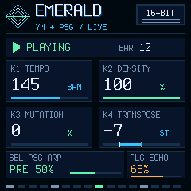

# Emerald YM

Generative 16-bit music firmware for the **M-VAVE FM-1**, by **CaspiusLabs**. A real YM2612 emulator, a lightweight Sega-style PSG and an endless sequencer turn the FM-1 into a small chiptune instrument. Play along on its keyboard and shape each instrument independently.

**Current development release: 0.3.1 (beta).** [Download](https://github.com/CaspiusLabs/Emerald-YM/releases/tag/v0.3.1) · [User manual](docs/MANUAL.md) · [Installation](docs/INSTALLING.md) · [Build from source](BUILDING.md) · [Test evidence](docs/VERIFICATION.md)



*240 × 240 render of the firmware UI, not a photograph or a browser emulator.*

## What it does

- Five YM2612 FM voices plus percussion through the emulated channel-six DAC, with the NTSC chip clock.
- Three Sega-style PSG tone voices and white noise. The keyboard plays up to three live PSG notes alongside the backing music.
- Seeded melodies, bass, chords and changing arrangements; tempo, density, mutation and transpose controls.
- Independent levels and DECAY, COLOR and ECHO settings for twelve sources. All three effects can run together.
- A screen that redraws only changed tiles, active-note LEDs and a documented USB MIDI/status interface.

This is original generative music inspired by the Mega Drive/Genesis sound palette. It contains no Sonic game music, extracted game samples or Sega logos. It is an independent project, not affiliated with Sega, Yamaha or M-VAVE.

## Quick controls

Start with MASTER low, then press PLAY. The sequencer is paused after boot.

| Control | Function in 0.3.1 |
|---|---|
| PLAY | Start/pause the backing sequencer; live keys still work in pause |
| REC | Generate a new seed and sequence |
| SEQ | Toggle mutation between 0 and 35 |
| K1 / K2 / K3 / K4 | Tempo / melody density / mutation / transpose |
| SELECT | Select one of twelve instruments |
| PRESETS | Set the selected instrument's level, 0–100% |
| FX | Select DECAY, COLOR or ECHO for editing |
| ALGORITHM | Set the selected effect amount, 0–100% |
| ARP | Enable/disable all PSG, including live keys |
| Keyboard | Up to three live PSG notes, F3–G5 |
| MASTER | Overall output level |

Effect amounts and levels remain independent when changing selections. Settings are held in RAM and reset on power-off; there is no project/preset save feature. With three live notes, the PSG arpeggio yields its voice; FM and DAC continue. See the [manual](docs/MANUAL.md) for details.

## Compatibility and data

Target: M-VAVE **FM-1**, not SMK-37 or other models. USB MIDI name: `Emerald YM FM-1`. Release identity: `FM-1_68000301`. The `.fwsc` includes the inherited Felucca update loader.

Emerald YM does **not** import stock, DUB-1 or other firmware's presets, projects or samples. It does not provide a way to back them up or restore them. Back up with your existing firmware's tools before switching. Firmware installation writes flash; do not assume another firmware's data will survive switching or recovery. Normal Emerald knob/FX changes do not automatically save to flash.

USB audio is disabled: listen on the FM-1 speaker or headphone output. This is a restricted musical chip profile, not a general VGM/register player or a full Genesis emulator. There is currently no Emerald browser player or editor; inherited DUB-1 web tools are historical code.

## Release status

0.3.1 passed desktop audio/UI/LED tests and update simulations. Its physical 30-second backing-plus-live test recorded CPU MAX **65%**, XRUNS **0**, overload blocks **0**, with neutral FX. The identical DSP in 0.3.0 passed a separate all-source FX test at **68%**. These are specific tests, not proof of every setting or long-session reliability.

The immutable, user-accepted **v0.1.4** remains the development baseline. Older interactive reports retain their original failed continuity results. [Verification](docs/VERIFICATION.md) separates desktop tests, simulations and physical evidence.

**Firmware Hub preparation:** metadata and a release package are provided, but listing readiness still requires the physical V15 → Emerald, another firmware → Emerald, and Emerald → another firmware checks. See the [submission checklist](docs/FIRMWARE-HUB.md). The repository remains private until the owner chooses to publish it.

## Development

The canonical repository is [CaspiusLabs/Emerald-YM](https://github.com/CaspiusLabs/Emerald-YM). Work in a local clone, commit changes and push to this repository. The original DUB-1 remote is reference-only.

```powershell
git clone https://github.com/CaspiusLabs/Emerald-YM.git
cd Emerald-YM
# Provision the ignored .runtime dependencies first; see BUILDING.md.
.\build-ym-windows.ps1
.\test-ym-windows.ps1
```

These commands do not open MIDI ports or flash hardware. `VERSION` determines the firmware version. Documentation-only changes do not change the installed binary. See [BUILDING.md](BUILDING.md), [architecture](docs/ARCHITECTURE.md), [CHANGELOG](CHANGELOG.md), [USB protocol](YM-USB-PROTOCOL.md) and [contributor handoff](AGENTS.md).

## License and credits

The combined firmware is **GPL-3.0-only**. It uses the DUB-1/AMB-1/Felucca platform lineage, Aaron Giles's **ymfm** (**BSD-3-Clause**) and original Emerald engine/PSG/FX code (**MIT**). JieLi package inputs and fonts retain their licenses. Full provenance and redistribution terms: [LICENSING.md](LICENSING.md), [LICENSE](LICENSE), [LICENSE-emerald.txt](LICENSE-emerald.txt).
