# DUB-1

DUB-1 (a working name) turns the M-VAVE FM-1 into a generative dub techno machine. It plays itself
from the moment it's switched on: chord stabs through a resonant low-pass into a tape echo, short
FM pings on loops of unequal length, a sub bass on one of five grooves, a kick that ducks the rest
(four on the floor, or sparser, a phrase at a time), a shaker and an open hat, and a crackle that
rings on the chord. An eight-bar arrangement takes the kick out for a break, thins the layers and
brings them back with a fill, and now and then a stab is thrown into the echo. You don't play it,
you steer it: pick a piece and a scale, take notes out, open the filter, push the feedback, hold
the echo.

DUB-1 is a fork of AMB-1, Charles Vestal's generative ambient firmware for the FM-1.

, running DUB-1, each control labelled")

---

## Contents

1. Install
2. Getting started
3. Controls
4. The screen
5. The layers
6. The arrangement
7. The pieces
8. The pages
9. MIDI
10. Saving
11. Troubleshooting
12. Parameters
13. Credits

---

## 1. Install

**Try it first** in the browser, with no FM-1: <https://sbegueria.github.io/fm1-dub/emu/>. It's the
same code the FM-1 runs, with sound.

**Install from the browser:** open <https://sbegueria.github.io/fm1-dub/install/> in Chrome or Edge
(they have Web MIDI), connect the FM-1 with a USB data cable, switch it on and press Install. Nothing
to install on the computer. Don't unplug it while it's writing; when it finishes, the FM-1 restarts
into DUB-1.

**Or from the command line:** download `dub-1.3.0.fwsc` from the
[releases](https://github.com/sbegueria/fm1-dub/releases), install Python 3 with
`pip3 install mido python-rtmidi`, and run, in a checkout of the source:

```
python3 tools/fm1_install.py dub-1.3.0.fwsc
```

**Go back:** the installer page's "Back to the stock firmware", or M-VAVE's own updater, M-UPGRADE,
puts the stock firmware back.

> Installing other firmware is at your own risk. If the FM-1 ever won't start, see
> [Recovering an FM-1 that won't start](#recovering-an-fm-1-that-won-t-start).

---

## 2. Getting started

DUB-1 starts playing as soon as it's on. A few minutes with it:

1. **Listen.** The first piece, Basic, is playing: F Dorian at 122, saw stabs into a dotted-eighth
   echo, an offbeat sub, the kick, the shaker and the open hat. Turn MASTER for the volume.
2. **Try another piece.** Turn PRESETS. Each of the eight pieces has its own key, tempo, sounds,
   groove and amount of movement.
3. **Change the scale.** Press a key whose note is lit: it leaves the scale, and nothing plays it
   any more. Press it again to bring it back. Any key that isn't lit adds its note.
4. **Move on.** Press EDIT: the chord moves to the next one at the start of the next bar.
5. **Hold the echo.** Press REC: dub hold. The echo stops listening and repeats what it holds,
   over and over, while the stabs, pings and drums go on dry above it. Press REC again to let it go.
6. **Shape a layer.** Each layer has a button: ENV the chord, ARP the pings, LFO the bass, SEQ the
   drums, SAVE the noise, FX the space (again, the Echo page), HOME the whole (the Dub page; again,
   the Key page: tempo, root, mode, swing), GLO the setup. KNOB 1–4 set the four values at the
   bottom of the screen; while one turns, the line above them says what it does. SELECT steps
   through the pages, in the order their buttons sit on the panel. Try Cutoff on the Chord page, or
   Feedback on the Space page. Or turn the Filter on the Dub page (KNOB 1) down, and
   bring it back. On a layer's page, OCT− and OCT+ turn that layer down and up; both together, a
   quick press, mute it (and bring it back).
7. **Rest.** Press PLAY: the music stops and the echo and reverb ring away. PLAY again and it
   starts from the top of a phrase.

What you change is kept with the piece. DUB-1 saves it by itself while resting, or hold GLO for half a second (or turn Setup's KNOB 4).

Want a new colour? Hold a layer's button (ENV, ARP, LFO or SEQ) for half a second: its sound takes a small step somewhere new.

---

## 3. Controls

The drawing at the top shows them all; here they are in more detail.

| Control | What it does |
|---|---|
| Keys | The scale. Each key adds its note to the scale or takes it out; the keys light up for the notes in it. Every octave of a note is the same key. The root stays ("THE ROOT STAYS"), and the scale keeps at least three notes ("3 NOTES AT LEAST"). |
| PLAY | Play / rest. DUB-1 starts playing by itself when it's switched on. At rest, the echo's feedback eases under 90% so its tails die away, the reverb rings out and the noise fades. Playing again starts from the first bar of a phrase. Lit while playing. |
| REC | A tap: **dub hold**: the echo stops listening and repeats what it holds, sample for sample, for ever; the reverb stops listening too and rings on; the chord doesn't move. The stabs, pings and drums go on, dry, above it. Tap again to let go. Lit while held. Held: the **effects grid** (below). |
| EDIT | A tap: the **Chords page** (below): the eight chords coming, to see and change. Held on (1.5 s): **new chords**, the walk's all walked again (yours, the gaps and the one playing kept). Held (half a second): the next chord, at the start of the next bar (at once while resting; in dub hold, once you let go). |
| SEL | **PERFORM**: the knobs become the master actions (Filter, Dub, Energy, Space) and the keys stop being the scale: they mute and solo the layers, make the dub moves, and white 6 held puts the mix on the knobs (see below). Press again to go back; lit while on. Held: the key map. |
| HOME | The Dub page: the Filter and the machine's movement. Again: the Key page (tempo, root, mode, swing), and again back to Dub; HOME blinks on the Key page. |
| ENV · ARP · LFO · SEQ | The layers' pages: Chord, Pings, Bass, Drums. Held (half a second): a **nudge** to the layer's sound; held on (1.5 s): a **shake** (below). |
| FX · GLO | The Space page (FX again: the **Echo page**, FX blinking; again, back); the Setup page, for what holds for every piece. The lit button shows the page. FX held: a nudge to the space; held on: a shake (a new echo time). **GLO held** (half a second, then let go): **saves** all eight pieces; held on (1.5 s): the piece back to its recipe. |
| SELECT | The previous or next page, in the order the page buttons sit on the panel, the top row then the bottom one: **Space** (FX), **Chord** (ENV), **Bass** (LFO), **Setup** (GLO), **Dub** (HOME), **Noise** (SAVE), **Pings** (ARP), **Drums** (SEQ). The eight dots at the right of the knob row show where you are, in the same order. From a sound page, the Echo page, the Chords page, PERFORM, or the Noise page opened with SAVE, it goes on from the page you came from. Hold HOME and turn it for the tempo, from any page. |
| ALGORITHM | On a layer's page (Chord, Pings, Bass, Drums): that layer's **voice** (see [The voices](#the-voices)). On the Noise page: its character. On the Chords page: the walk's character (Home, Wander, Free). Anywhere else: the middle of the screen, as ripples, a scope or a spectrum (see [The screen](#4-the-screen)). The mode, a piece's choice, is on the Key page (HOME again). |
| PRESETS | The piece (see [The pieces](#7-the-pieces)). |
| KNOB 1–4 | The four values on the screen. A few clicks are always single steps; a quick turn speeds up, so half a turn sweeps the range. While a knob turns, the line above the knobs says what it does. |
| OCT− / OCT+ | On a layer's page (Chord, Pings, Bass, Drums or Noise, and their sound, FM and Pattern pages): that layer's **level**, 5 down or up a press ("BASS 55" in the header, and a big ring in the middle, in the layer's colour, the level inside, until a second after the last press); held, it keeps going. **Both together**, let go within a second: the layer **muted** ("BASS MUTED"), its level kept; again, back ("BASS ON"). The drums mute the kick and the hats together. These are PERFORM's mutes (white 1–5): a mute made here shows there, and the other way round. Held together for five seconds: the update mode (see [Troubleshooting](#11-troubleshooting)); a long press never mutes. On the other pages they do nothing. (The pings' octave is on the Pings page, KNOB 4.) |
| MASTER | Volume. |
| SAVE | The **Noise page** (below); again, back. Held: a nudge to the noise; held on (1.5 s): a shake (another noise character). Saving is on GLO. |

**PERFORM** (SEL). The knobs become the **Perform** page, the master actions, each acting on the
whole music. They are 0 in the middle (the piece as it is), and on the way through the knob stops at
the middle, so it's easy to find:

| Knob | Down | Up |
|---|---|---|
| KNOB 1 · **Filter** | Shut 1–100: a low-pass on the music, down to about 230 Hz: under water | Open 1–100: a resonant high-pass, up to about 400 Hz: thin and bright |
| KNOB 2 · **Dub** | less echo: a lower send and shorter feedback, dry and tight | more echo: a higher send, feeding back longer, towards a runaway |
| KNOB 3 · **Energy** | sparser and drier: fewer and quieter pings, fewer and quieter hats, fewer and shorter stabs, a thinner bass line, a sparser kick; past halfway, the next phrases go Thin (no bass, no shaker) | busier and brighter: more of each, louder hats, longer stabs, a thin bass filled back in, the kick nearer four on the floor; past halfway, the phrases stay Full, with a fill into each |
| KNOB 4 · **Space** | drier: less reverb and cloud, a smaller plate | wider: more reverb and cloud, a longer plate |

The Filter is the same as KNOB 1 on the Dub page (one value, on both pages); the kick is always
left out of it, so it keeps pumping under the filtered music. PERFORM's Open and Shut keys push on
top of it. The master actions are for playing: they aren't saved, and they stay where they are when
you change piece (turn the Filter down, change piece, open it again), back in the middle when the
FM-1 starts.

**Hold white 6** for the **Mix** page: KNOB 1–4 the levels of the chord, the pings, the bass and the
drums (the same levels OCT− / OCT+ set on each layer's page), until you let go. SELECT or a page's button still
takes you to the other pages while you perform, and SEL again leaves PERFORM where you are (from the
Perform page, back to the page you started from). The keys, from the lowest up, are three sets, with
white 6 between them. Each key that does something is lit (hold SEL for this map on the screen):

| | 1 | 2 | 3 | 4 | 5 | 6 | 7 | 8 | 9 | 10 | 11 |
|---|---|---|---|---|---|---|---|---|---|---|---|
| **Black keys:** solo | Chord | Pings | Bass | Kick | Hats | | | | | | |
| **White keys:** mute, mix, moves | Chord | Pings | Bass | Kick | Hats | Mix (held) | Throw | Open | Shut | Drop | Echo |

The first five black keys (F♯ G♯ A♯, C♯ D♯) sit above the five mutes, like a mixer's channel strip.

- **White 6, held:** the Mix page on the knobs. It blinks slowly in PERFORM, so it's easy to find, and goes dark while held. The mutes still act the moment
  you press them, with or without it.
- **White 1–5, the chord, pings, bass, kick and hats:** a press mutes the layer, another brings it
  back; lit while it plays. The levels stay as they are (a true mute: the Mix knobs don't move). They
  are the same mutes as OCT− + OCT+ on a layer's page (there, the drums' mute is the kick's and the
  hats' together): a mute made either way shows on the other. The mutes stay when you leave PERFORM.
  The music goes on underneath: a muted layer comes back where it would have been.
- **Black 1–5, solos:** a press solos the layer: the others go quiet (their echoes and reverb ring
  out), and SOLO shows at the top of the screen. Solo more than one and they play together; press
  again to let one go. A soloed key blinks; the white keys show what you hear. Solos stay when you
  leave PERFORM, as the mutes do.
- **White 7–11, moves, held** (lit; dark while held):
  - **Throw:** every stab is thrown into the echo.
  - **Open:** the music thins and brightens over the kick: a resonant high-pass on everything but
    the kick sweeps up to about 400 Hz, and the chords' filter opens three octaves and sings, the
    echo's band-pass and the pings brighter with it.
  - **Shut:** the music goes under water while the kick keeps pumping: a low-pass on everything but
    the kick sweeps down to about 230 Hz, the chords' filter and the echo's band-pass closing with it.
  - **Drop:** the floor falls away: the kick and the bass out while held (the bass let go at once),
    both back on the next beat when you let go. The kick's mute (white 4) takes it out until you
    press again; Drop is the move you hold for a bar or two and release on the downbeat.
  - **Echo:** the echo pushed: everything into it, feeding back more.
  - Each sweeps in over about half a second; letting go eases back (to where the Filter knob is).
- The other keys do nothing in PERFORM; MIDI notes in still change the scale.

**The Chords page** (EDIT tapped): the chord machine, in view. The progression is eight slots. Each
slot is one of three:
- a chord from **the walk**, in teal: the random walk over the scale's degrees (see
  [The arrangement](#6-the-arrangement)). It's a degree of the scale, so it follows the key and the
  mode when you change them;
- a chord **you wrote**, in white: as written, whatever the key;
- a **gap**, "(HOLDS)": the chord before it goes on.

| | |
|---|---|
| KNOB 1 · Slot | the slot you're editing (1–8), outlined on the screen |
| Keys | its root, any note (lit on the keys). A walk's chord becomes yours, keeping its kind and type; a gap becomes a minor chord on it |
| KNOB 2 · Chord | its kind: Empty (a gap), Major, Minor, Sus2, Sus4, Dim, Aug. Turning a walk's chord makes it yours |
| KNOB 3 · Type | Triad, 6, 7, Maj7, 9, 11, Add9 |
| KNOB 4 · Play | **Endless** or **Loop** |
| ALGORITHM | the walk's character: **Home**, **Wander** or **Free**. Its chords (the teal ones) are walked again at once, all but the one playing; yours and the gaps stay. The character shows at the left of the knob row |

**Home, Wander, Free** (ALGORITHM; Wander is the default) set how the walk moves, from the most settled to the
most varied. Turning ALGORITHM rewrites the walk's chords on the page straight away, so you see and hear the
change; in Loop it rolls a new loop from the teal slots (turn until you like it, then leave it). **Home** goes back to the home chord often (about two times in three) and leans on the IV, the
way DUB-1 has always moved. **Wander** goes home less, spreads over more of the scale's chords and rarely
bounces straight back to the chord before last. **Free** goes home least and treats the other chords evenly.

**Endless:** a new piece starts with eight chords from the walk, from home. The chord
playing is always slot 1. When it moves on (every Drift bars, or EDIT held), every slot moves up one:
a gap stays a gap, your chords stay yours. The walk then writes a new chord into slot 8, so you see
the chords coming and can change them before they arrive.

**Loop:** the eight in turn, from the one playing, a chord every Drift bars, round again after the
last that isn't a gap. Nothing new is written. Gaps at the end make the loop shorter. Switching from
Endless to Loop keeps the eight you see, to catch a progression you like as it goes by. Back to
Endless, the one playing moves up to slot 1 and the walk goes on.

Editing the slot that's playing is heard at once. The slot playing is lit; in Loop the other pages
show "2/4" under the chord's name. EDIT again, or any page's button, leaves the page; **EDIT held**
(half a second), anywhere, moves to the next chord. The slots are kept with the piece.

**The effects grid** (REC held). After a moment the whole screen shows sixteen effects, four rows of four (the knobs do nothing while it's up);
the white keys from the lowest play them, each as long as its key is held (even after you let go of
REC). The first key of each row is lit, to find the rows by touch.

| Row | Key 1 | 2 | 3 | 4 |
|---|---|---|---|---|
| Echo (white 1–4) | **Throw**: every stab thrown into the echo | **Time x2**: the echo's time doubled (halved if the tape is too short), gliding there and back | **Tape stop**: the echo's tape slowing to a quarter, its pitch diving | **Swell**: everything into the echo, feeding back more |
| Filter (5–8) | **Low**: a low-pass on everything, sweeping down to 350 Hz | **High**: a high-pass, up to 1.3 kHz (thin, a radio) | **Wah**: a resonant band sweeping, 1.3 times a second | **Phone**: a narrow band, 450 Hz to 3 kHz, overdriven |
| Space (9–12) | **Verb**: everything into the plate | **Crash**: a burst of noise into the plate, a splash | **Freeze**: the cloud stops listening, its grains thick and brought forward | **Wash**: the dry down, everything into the echo and the plate |
| Rhythm (13–16) | **Stutter**: a sixteenth of the mix caught and looped | **Gate**: the chord ringing on, chopped in sixteenths | **Siren**: the dub siren, into the echo | **Riser**: noise rising through a band-pass, louder as it climbs |

A tap on REC alone is still dub hold; held long enough for the grid (or with a key played), its
release does nothing. Each effect eases in and out. All sixteen at once is the heaviest thing DUB-1
can do: in a heavy piece it can approach the FM-1's limit (watch the Setup page's CPU).

**The nudge** (ENV, ARP, LFO or SEQ held for half a second). The layer's sound takes a step somewhere new:
three or four of its sound values move, each up to an eighth of its range (up to 12 on a −50…+50 value), like a
random walk. The walk is pulled back to the piece's recipe: the further a value has gone, the likelier its next
step goes back (a quarter of the range away, always), so nudging again and again explores round the piece's
sound and never wanders off. The message says the biggest change ("CHORD NUDGE Colour +5"), and
the layer's sound page comes up with that knob lit (in PERFORM, you stay where you are).

**The shake** (keep holding, 1.5 s): the wild one. The layer gets **another voice** (the drums another kit;
the chord's Noise is left to ALGORITHM) and every one of its sound values takes a big step. The message says the
new voice ("CHORD SHAKE Keys").

| Held | Nudges |
|---|---|
| ENV | the chord: Attack, Colour, Reso, how far each stab opens the filter (Env: the voice's, on no page), its Decay and Cutoff a little; on an FM voice, its ratio and feedback |
| ARP | the pings: Tone, Ratio, Length, Bend, Ghost (an FM voice: its ratio and feedback); now and then one note of one loop |
| LFO | the bass: Bite, Shape, Length, Slide, the Fifth (an FM voice: its ratio and feedback); its shake also moves the **groove** to a neighbour (Drone, Offbeat, Dotted, Sync, Roller, in that row) |
| SEQ | the drums: the kick's tune, length and punch, the hats' tone and level |
| SAVE | the noise: Tone, Density, Decay, Air; its shake: another noise character |
| FX | the space: the echo's send and feedback (smaller steps), the reverb, the plate's size, the cloud; its shake: a new echo time |

Saving (GLO held) keeps what you like; GLO held on (1.5 s) puts the piece back to its recipe. Evolve nudges by itself too (the Dub
page, below), but never shakes.

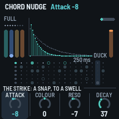

---

## 4. The screen

")
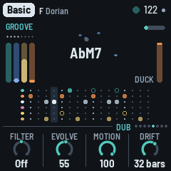

- **Top line:** the piece in a tag, its root and mode. On the right, a beat light (a play triangle
  while resting), the tempo (EXT when it follows MIDI clock), a dot when there are unsaved
  changes, and the battery: three bars (the outline red when it's nearly empty), or the bars filling
  in turn while USB powers and charges it. Messages ("ADDED F#", "NEXT CHORD ON THE BAR", "DUB HOLD ON", "KICK OFF") show here for
  a moment.
- **Top left:** the section playing (FULL in grey; BREAK, GROOVE and THIN lit up) and eight dots,
  the phrase's bars, lit up to the bar playing.
- **Top right:** a thin bar fills up on the way to the next chord (none when Drift is Hold); in
  dub hold it says "hold" in red instead. PERFORM, when SEL's mode is on.
- **The ripples:** each stab drops a ring in the middle that spreads and fades. Its outline is the
  sound itself at that moment, its wave wrapped round the circle: a soft pad a smooth ring, a
  bright stab a jagged one. The echo's repeats follow it, a ring each echo time, each as strong as
  the echo's output really is then (measured, not worked out), and a little smoother each time
  round, as the tape darkens them. So a long Feedback makes long trains of rings, a short one a
  single ring, and a filtered, ducked or dropped echo shows as it sounds. A stab thrown into the
  echo makes a thicker, brighter ring. In dub hold the rings turn red, and a new stab makes a
  single ring (the echo plays what it holds). The chord's name is in the middle (red in dub
  hold). Around it the four ping loops each circle as a blue dot, one step a turn's step: its
  place is where the loop is, and it lights up when the loop plays a ping (dim, a ghost, between).
  The loops have different lengths, so the dots drift apart and meet again.
  Under it all, the noise: a grey speck for each of its hits you can hear, and for each dry click
  (on its side), as bright as it is loud, gone in a moment; a strong hit a brighter one. More
  Level or Density (the Noise page), more specks. The specks show on the whole piece's ripples
  only, not on a layer's page.
- **ALGORITHM** (on any page but a layer's, the Noise page or the Chords page) changes what the middle shows: the ripples, a **scope** or a
  **spectrum**, and then the ripples again (turned back, the other way round). Each piece keeps its own view, saved with it: Haze on the spectrum, say, and Pressure on the scope. With the
  scope or the spectrum showing, the chord's name moves to the top.
- On a layer's own page (Chord, Pings, Bass, Drums), the middle shows **that layer alone**: the ripples its notes, in
  its colour (the stabs on the Chord page, the pings with their loops' dots on the Pings page, a ring a bass note, a
  ring a drum hit), and the scope or the spectrum its sound, dry. The lanes below keep showing the whole bar, the
  layer's own in colour and the others in grey (the pings and the noise have no lane: all grey). The Noise page
  always shows the spectrum, of the noise alone. Dub, PERFORM, Space, Echo and the other pages show the whole piece.
  - The **scope** draws the output (left and right mixed) as a thick line. Each trace starts on a
    rising zero crossing so the picture stands still, and the two traces before it fade behind.
    Its height follows the level, so a quiet passage still fills it.
  - The **spectrum** splits the output into 18 bands, from the sub bass (43 Hz, left) to the hats
    (11 kHz, right). Each band is a column of segments: teal, then brass, amber and red at the
    top. The columns jump up with the sound and fall back slowly. A white cap stays at each
    column's peak for a moment before it drops.
- **Left:** the four layers' levels as they sound: chord (teal), pings (blue), bass (brass),
  drums (amber).
- **Right:** DUCK, how far the beat is ducking the rest, falling from the top with each kick (and,
  less, on each beat without one).
- **The lanes:** the bar as it plays, sixteen steps, a lane a layer, each marked in its colour on
  the left: the stabs (teal), the kick (amber), the hats (white), the rim (pink), the clap (yellow), the bass (brass).
  A hit that only sometimes comes (the clap in Auto, a lane's Chance under 50%) is a ring, filled when it plays. The step playing
  is lit. A layer that's out (in a Break, muted in PERFORM, or at level 0) has an empty lane at once.
  In the stabs' lane, rings show where the echo's repeats land, fainter for each, as the echo's
  time and Feedback have them; each flashes white as the playhead reaches it.
- **Bottom:** the page's name and eight dots, one a page, then its four values, one for each knob:
  a dial (or, for a switch, its positions) and the value. The one you're turning lights up, and
  while it turns, the line above says what it does ("HOW LONG THE REPEATS GO ON"); a moment after,
  the page's name and dots are back.

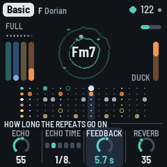
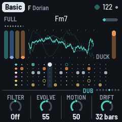
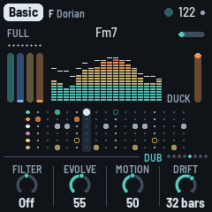
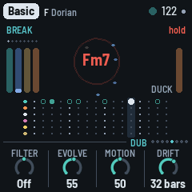
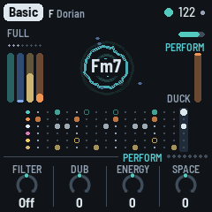

---

## 5. The layers

DUB-1 plays four layers from one scale and one chord, on a grid of sixteenths.

- **Chord:** the stab. Four voices struck together, each two saws a few cents apart, or an FM
  electric piano (**Keys**), through a resonant low-pass that opens with each stab and closes
  again, then a soft clip. The stabs fall on a Euclidean pattern over the bar, off the beat. One
  voicing (an open minor 7th, root, fifth, seventh and tenth; or a ninth without its fifth) is
  shifted whole to each new root, the way a chord memory does, its root kept between F#2 and F3. Much of
  the stab goes to the echo (**Ghost**, on the Chord page, sets the dry against it). Every so often (**Drift**) the chord moves to another degree of the
  scale: in a seven-note scale, most often the fourth, then the seventh, the fifth and the sixth; away from home, back
  home about two times in three. It never moves to a half-diminished chord.
- **Pings:** short FM blips played by four loops 13, 17, 23 and 29 eighths long. Each loop holds a
  few notes of the chord (now and then a passing note, or a note an octave up), each in its own
  register, place in the stereo field and shade of tone, so the loops slide against each other.
  They go mostly into the echo.
- **Bass:** a sub on the chord's root, sometimes its fifth, in the sub's band (E1 to Eb2 at home),
  on one of five grooves: Drone (one long note a bar), Offbeat (the four off-beat eighths), Dotted,
  Sync and Roller, all its notes or fewer (**Density**). It slides briefly from note to note. It stays dry, out of the echo.
- **Drums:** a kick (a sine falling fast onto the key's root, F1 to B1, 44 to 62 Hz; below F its fifth; with a click), a
  shaker on the sixteenths, an open hat off the beat, and a **rim** (two short tones and a click,
  mostly sent into the echo, so it echoes away: the dub snare), on two and four once Hits is 70 or
  more; and a **clap** (three quick bursts of noise and a tail, into the plate), rarely: on two or
  four now and then, about one chance in twenty (a little more with Evolve), in Full and Groove phrases.
  The kick plays a **shape** a phrase at a time: none, the downbeat alone, one and three, four with
  two and four ghosted (10 dB down), or four on the floor. **Density** (the Drums page) is where the
  shapes centre; at 100 it's four on the floor, always. The kick ducks everything else (**Duck**),
  and stays out of the echo; the hats send a little to it. On a beat with no kick the music still
  breathes, ducked a little less (less again while the kick is out, as in a Break): the **ghost
  duck**, so the pumping goes on whatever the kick does.

Then the space: the tape echo (up to 5.6 seconds, synced to the tempo), a granular **cloud** and
Dattorro's plate reverb. The cloud records what goes to the reverb (the last 0.74
seconds, at a quarter of the sample rate) and plays it back in grains: up to six at a time, each
80 to 250 ms from anywhere in what it holds, at a random place in the stereo field, now and then
an octave down (rarely up). The grains go into the plate, so they bloom into its tail, and the
plate's tail goes back into the cloud: with **Cloud** up the reverb turns into a moving wash, longer
with a bigger plate. The grains come thicker as the filter opens, and in a Break there is more of
the cloud. Dub hold freezes the cloud as it does the echo.

**The echo dissolves.** What goes into the tape is band-limited first (**Tone**, on the Echo page)
and smeared through a chain of allpass filters, and each repeat goes through three more on its way
round (**Blur**): every repeat comes back softer and darker than the one before, not a clean copy,
until it melts into a wash. In the feedback, a band-pass also makes each repeat thinner and
darker, and moves with the arrangement. **Feedback** (the Space page) is how long the repeats go
on, in seconds: the loop's gain follows the echo's time, so a long echo dies away as soon as a
short one. A throw, PERFORM's Dub and the grid's Swell push it further; a soft clip lets the
feedback pass 100% then, so the echo swells on itself without running away. The echo plays from
one head, near the middle of the stereo field (**Width** spreads it); a second head, at three
quarters of the loop, joins in only while a thrown stab rings, to the right. With **Motion** up,
the heads wander across the field, and every so often the second head slides to another part of
the loop (two thirds, a half, three eighths, a quarter), bending its repeats in pitch on the way.
The stabs and the pings sit nearer the middle too, so the echo has the sides.

Under it all, **the noise** (the Noise page): a crackle groove that rings on the chord, and a quiet
hiss (see [SAVE: Noise](#save-noise)). It plays only while the music plays, fading in and out over
about half a second.

**Dub throws:** now and then a stab is thrown hard into the echo, which pushes the feedback up
for a moment: the repeats come back louder, and the stab's dry is 6 dB down, so it's the echo you
hear. **Throws** (the Chord page) sets how often: at 50, about one stab in eight; at 100, about one
in three; at 0, none but the last stab of a fill, which is always thrown. There are more in a
Break. Evolve lets them in: at 0 there are none, and from 40 up Throws has them all.

**Evolve** also keeps the patterns moving and the playing loose: every two bars the stab pattern
may turn a step or gain or lose a stab; stabs drop out of a bar, and now and then a whole bar has
none, the echo carrying it (about one bar in five at Evolve 40, never in a Break); each stab has
its own cutoff, a little darker or brighter; the shaker's steps trade places or gain or lose one,
and in Auto the hats are looser (a shaker step or an open hat left out now and then, a hit a
few milliseconds late); a ping changes note or moves at the end of a pass, a
ping loop sits a pass out, the bass jumps an octave up for a note, and when the chord moves it may
change voicing. It also widens how far the kick's shape wanders from Density. As Evolve goes to 0
all of this tightens: at 0, every stab plays every bar, the same cutoff, no throws.

---

## 6. The arrangement

DUB-1 plays in phrases of eight bars. Each phrase is one of four sections:

| Section | What plays |
|---|---|
| **Full** | Everything. The filter sweeps somewhere between a little dark and open. |
| **Break** | The kick, the bass and the shaker out (the open hat stays only while Motion is under 50); the music still breathes on the beat, lightly. The filter goes dark, then from the third bar opens up over two bars or so. Throws are more likely. The noise's hits fewer, ringing longer. |
| **Groove** | Every other stab of the pattern; the filter in the middle. |
| **Thin** | No bass, no shaker; the kick's shape a step sparser. The filter a little darker. The noise's hits fewer, ringing longer. |

In the last bar of each phrase, the next one is chosen. **Motion** sets how often it leaves Full:
at 0, never; at 50, about one phrase in three; at 100, more than half the time. When it leaves, a
Break is the likeliest, then a Groove, then Thin. From any other section it goes back to Full
three times in four (or else from a Break to Thin, from the others to a Break).

**Fills:** the last bar before the kick comes back from a Break is always a fill, and other
phrases end with one now and then (more often with Motion up; never at Motion 0), unless a Break
follows. In a fill
the kick (if it's playing) drops out for the second half of the bar, the open hat plays (if Hits
gives it any steps), and the last stab is thrown into the echo.

**The sweep:** the arrangement moves a slow filter sweep, from dark to open, and Motion sets how
far it goes (at 0 it stays put). It opens the stabs' filter (up to an octave and a half either
way) and its resonance, moves the echo's band-pass, thins the pings in the dark, moves the noise's
tone and takes a little off the reverb when it's open.

**The kick, a phrase at a time:** as each phrase starts, the kick takes a shape for its eight bars
(none, the downbeat, one and three, four with two and four ghosted, four on the floor), drawn
round the Drums page's Density: the nearer a shape is to it, the likelier. Evolve lets it wander
further; a Thin phrase takes it a step sparser; Energy (PERFORM) moves it. At Density 100 it's
always four on the floor. With the Pattern page on Pattern, your kick lane plays instead.

---

## 7. The pieces

PRESETS chooses one of eight pieces. Each is a recipe for the whole machine: the layers, the
sounds, tempo, key and mode, the groove, the space, how busy it is and how far it moves. Each
remembers how you left it. Hold GLO for 1.5 s to put the piece you're on back to its recipe.
Tune, MIDI out and Lights are the same for all.

| Piece | What it is |
|---|---|
| **Basic** | F Dorian, 122: the reference. Saw stabs into a dotted-eighth echo, an offbeat sub, the kick mostly four on the floor, a vinyl crackle; a new chord every 32 bars. |
| **Chamber** | A minor, 118: one chord that never moves (Drift on Hold), organ stabs, longer and darker, a long echo tail, a drone bass, straight time, fewer hits, a kick that comes and goes, the noise ringing on the key (Room). |
| **Steppers** | D Dorian, 126: shorter, brighter, busier saw stabs, a dotted bass, a dotted-quarter echo, the kick mostly four on the floor; a new chord every 16 bars. |
| **Fog** | G minor, 112: FM keys, long dark stabs lost in a quarter-note echo and a big plate, a drone bass an octave down, soft drums, a kick that comes and goes, a tape hiss through the noise (Tape); the chord moves every 64 bars. |
| **Concrete** | C pentatonic minor, 130: the fastest. Chords stacked in fourths, short bright noise stabs, a rolling bass, the drums forward with bright hats and the kick on the floor, more swing, a metallic noise (Machine). |
| **Night Drive** | Bb Dorian, 124: FM keys, more pings, a half-note echo, a syncopated bass, the most swing, a tape noise; a new chord every 16 bars. |
| **Pressure** | E Phrygian, 128: the kick and the bass forward, the kick on the floor and the heaviest ducking, one chord held (Drift on Hold), little reverb, a quieter, darker crackle, the least movement. |
| **Haze** | Eb major, 116: pad stabs, the longest, the most echo and the longest tail, pings an octave up and the most of them, a kick that comes and goes, the most noise, dry and dusty (Dust), and the most Motion: it leaves Full most often. |

The pieces' echo tails run from about 4 to 8 seconds.

---

## 8. The pages

One page a part, each on its own button, with four values on KNOB 1–4. SELECT steps through them
in the order their buttons sit on the panel: Space (FX), Chord (ENV), Bass (LFO), Setup (GLO), then
Dub (HOME), Noise (SAVE), Pings (ARP), Drums (SEQ). This chapter takes them by layer.

Each layer's page starts with its **Density** on KNOB 1: how many stabs, pings, bass notes, kicks
or noise hits.

The layers' **levels** aren't on their pages: OCT− / OCT+ set them on each layer's page (and its
sound pages; the noise's on the Noise page), 5 a press, and both together mute it (see
[Controls](#3-controls)); PERFORM's Mix page (white 6 held) has the four together.

### The voices

On a layer's page, ALGORITHM steps through that layer's voices (after the last, the first again).
The voice's name shows at the left of the knob strip, and a message says it ("VOICE Organ").
Each piece keeps its own.

| Page | Voices |
|---|---|
| Chord (ENV) | **Saws** (two detuned saws a voice), **Keys** (an FM electric piano), **Organ** (four drawbars, longer), **Pad** (the saws swelling in, long), **Bell** (FM at 3.5, the clang dying first), **Tonewheel** (a second organ: drawbars, a quick percussion and a key click at each strike, a rotary speaker turning left and right), **Noise** (noise through the resonant filter, a little saw under it) |
| Pings (ARP) | **Blip**, **Marimba** (a wooden bar), **Glass** (long and bright), **Wood** (a knock), **Drop** (the pitch falling from an octave up) |
| Bass (LFO) | **Sub** (a sine and a little of its octave), **Punch** (FM, four operators stacked: a thump in the first 90 ms), **Rubber** (FM, two pairs, one an octave under, op 4 feeding back), **Pluck** (FM at 3, gone in 50 ms), **Growl** (FM at 1: a bite at each note) |
| Drums (SEQ), the kit | **Tight**, **Deep** (long, 808-ish), **Punch** (short and hard), **Soft** (a muffled thump, no click), **Dusty** (darker, noisier hats) |

The voices are matched in level, so changing one keeps the mix.

### The FM pages

Keys and Bell (chord), every ping voice, and Punch, Rubber, Pluck and Growl (bass) are **FM
voices**: sine operators modulating each other, as in the FM-1's own firmware and the 4-operator FM
synths. On those, the layer's button pressed a third time (after the sound page) opens its **FM
page**. On a voice that isn't FM (Saws, Organ, Pad, Tonewheel, Noise; Sub) the page says so and
names the FM ones: turn ALGORITHM there to pick one. Until you do, the page's knobs are grey, at 0, and do
nothing when turned (what you set on an FM voice is kept for when you come back to one).

- **Algo:** which operators modulate which. *Voice* (the voice's own), or one of the classic eight
  4-operator algorithms (1: a stack of four; 5: two pairs; 8: four sines side by side), or 2-op
  (one modulator into one carrier). The screen draws it: the carriers (heard) on the line, each
  modulator above the one it modulates, operator 4's feedback as a loop.
- **Ratio:** operators 3 and 4's pitch against the note, from half to twice the voice's.
- **Feedback:** operator 4 modulating itself: from pure to gritty, towards noise.
- **Mod dec:** how long the modulators take to fade: the brightness of each note's start,
  shorter or longer.

As on the sound pages, each is relative to the voice (0, or Voice), stays when the voice changes,
and is kept by the piece.

### The sound pages

Press a layer's button again (ENV on the Chord page, ARP on Pings, LFO on Bass, SEQ on Drums)
for its **sound page**: four more knobs that shape its voice. The button blinks while you're
there; press it again to go back, or go anywhere else as usual. ALGORITHM still changes the voice.

Each knob (but the chord's Decay) is **relative to the voice as it is**: 0, the middle, is the
preset; turning moves away from it, to −50 or +50. Your turns stay when you change the voice, so a
chord made slower and brighter stays slower and brighter on the next voice. Holding GLO 1.5 s (the
piece back to its recipe) puts them back to 0. Each piece keeps its own.

In place of the ripples, the screen draws the layer's envelope as it will sound, and how long it
lasts; the second, dotted curve is the chord's filter envelope, the pings' bend or the kick's pitch.

| Sound page | KNOB 1 | KNOB 2 | KNOB 3 | KNOB 4 |
|---|---|---|---|---|
| Chord | **Attack**: up, a slower strike, to a swell; down, a snap | **Colour**: as each voice has it: the saws' detune, the FM voices' brightness, the organs' upper drawbars, the noise against its saw | **Reso**: the filter's resonance | **Decay**: how long a stab rings, 0–100, from 60 ms to 1.5 s (times the voice's own length) |
| Pings | **Tone**: round to metallic (moves the piece's Ping tone) | **Ratio**: the FM modulator, from harmonic to clangy | **Length** | **Bend**: the pitch falling at the strike (up to from four times its note) |
| Bass | **Bite**: drive, and Growl's bite | **Shape**: up, towards a square; down, towards a pure sine | **Length**: how long each note holds, against its groove's | **Slide**: the glide between notes, ~1 ms to ~250 ms |
| Drums | **Kick tune**: semitones from the key's note, −12 to +12 | **Kick len** | **Punch**: the kick's start pitch and its click | **Hat tone**: dark to bright (moves the piece's hats colour) |

The chord's Decay is the voice's length times its own: an Organ or a Pad rings longer than Saws at
the same Decay. The filter's own envelope is quicker. How far each stab opens the filter comes with
the voice and the piece (a nudge still moves it).

### HOME: Dub

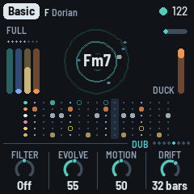

The song as it plays. **ALGORITHM** (here and on any page but a layer's, the Noise page or the Chords page): the middle of the screen as ripples, scope or
spectrum (see [The screen](#4-the-screen)). **HOME** again: the Key page (below).

- **Filter:** the DJ filter on the whole music but the kick. Down (Shut 1–100), a low-pass that
  takes it under water; up (Open 1–100), a resonant high-pass that thins it; Off in the middle,
  where the knob stops on its way through. It's PERFORM's Filter too (see [Controls](#3-controls)):
  for playing, so it isn't saved, and it stays where it is when you change piece.
- **Evolve:** how restless and loose it is: the stab pattern turning and gaining or losing stabs,
  stabs and whole bars dropping out, each stab's own cutoff, the shaker's pattern and looser hats,
  the pings' notes, loops sitting out, octave jumps in the bass, how far the kick's shape wanders,
  and whether there are dub throws at all (see [The layers](#5-the-layers)). At 0, with Motion at 0
  and the Drums page's Density at 100 too, it's a strict loop: every stab every bar, the kick four
  on the floor, no throws, no fills (good for playing along with other gear). Above 40
  it also nudges the sound by itself: now and then, on a phrase's first bar, one or two of one
  layer's sound values take a step (half a nudge by hand's), so over a long run the piece slowly
  changes colour (at 100, about every third phrase; at 40 and under, never). It never shakes.
  Above 60 it also moves the **bass's groove**, rarely, to a neighbour (Offbeat to Dotted, say), and
  back towards the piece's own later: at 100, every few minutes; at 60 and under, never. The groove
  away from home usually lasts a few minutes, so a long run's bass line slowly breathes.
- **Motion:** how often the arrangement leaves Full, how far the filter sweeps, how likely a fill
  is, and how much the echo's heads, the filter and the band-pass wander.
- **Drift:** how many bars a chord lasts before it moves on: 2, 4, 8, 16, 32 or 64 bars, or Hold
  (it moves only when you press EDIT). The chord moves at the start of a bar.

### HOME again: Key

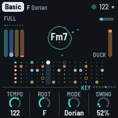

The piece's key and time, which a dub track seldom changes. HOME blinks while you're here; HOME
again goes back to the Dub page.

- **Tempo:** 90 to 140. Also HOME + SELECT, from any page.
- **Root:** the key's root note. The scale moves with it, and the chord at once.
- **Mode:** **Minor** (Aeolian), **Major** (Ionian), Dorian, Mixolydian, pentatonic minor and major, Phrygian, Lydian (the most common first; the screen shows Aeolian as Minor and Ionian as Major); it
  loads the mode's scale. Editing the scale with the keys
  makes it Custom.
- **Swing:** the off sixteenths late, from straight (50%) to a heavy lilt (70%): everything on them, the stabs, the bass, the pings and the drums, together.

### ENV: Chord

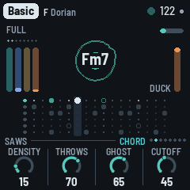

- **Density:** how many stabs a bar, from one (0 to 9) to six (90 and up), on a Euclidean pattern
  off the beat. Evolve may add or take one now and then, leave one out, or rest a whole bar.
- **Throws:** how often a stab is thrown into the echo: at 0, never (but the last stab of a fill);
  at 50, about one stab in eight; at 100, about one in three. More in a Break; none at Evolve 0. A
  thrown stab's dry is 6 dB down. PERFORM's Throw and the grid's throw every stab, whatever it is.
- **Ghost:** the stabs dry against their echo. At 0, up front, the dry at full and the echo as it
  was; at 50, the dry 6 dB down and a little more into the echo; at 100, the dry down to about
  −20 dB and the echo pushed further: almost all echo. The reverb stays as it is.
- **Cutoff:** where the low-pass sits, from 110 Hz to 5.4 kHz. Each stab opens it further for a
  moment, the arrangement's sweep moves it (with Motion), and with Evolve each stab sits a little
  higher or lower (up to about half an octave).

How long a stab rings (Decay) is on the Chord sound page (ENV again). The stab's sound, the voice,
comes with the piece (ALGORITHM changes it).

### ARP: Pings

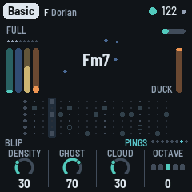

- **Density:** how many notes each loop holds, none at 0 to five at the top, a little fewer while
  the sweep is dark. A change shows up as each loop comes round.
- **Ghost:** the pings dry against their echo and reverb, which stay as they are. At 50, the dry
  6 dB under the sends' share; at 0, up front (6 dB more); at 100, the dry down to about −20 dB:
  almost all echo, ghosts of notes.
- **Cloud:** how much of the reverb goes through the granular cloud: at 0 the plate alone, at the
  top a thick wash of grains.
- **Octave:** the pings two octaves down to two up. While playing, a ping sounds at once in the new
  octave.

### SAVE: Noise

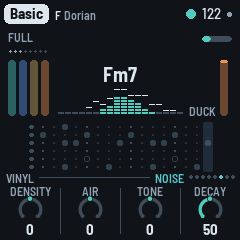

SAVE, a tap (again, back to where you were); it's on SELECT's round too, between Dub and Pings.
The noise isn't a bed of hiss but a voice of its own, played like the drums:

- **The crackle groove:** hits on a two-bar pattern of sixteenths, spread evenly (a Euclidean
  pattern), turned and with a hit or two nudged a step off, now and then one a quiet ghost. When a
  phrase starts the pattern is drawn again, or now and then kept, so a motif comes back (kept more
  often as Evolve falls). Break and Thin phrases have fewer hits.
- **Rung on the chord:** each hit is a short burst of noise that strikes three resonators tuned to
  the chord's root, third and fifth, low (E1 to Eb2), the root in the middle, the third left, the
  fifth right. They're retuned at each hit, so the crackle follows the chord. Then a band-pass
  (Tone) takes the top off: almost nothing above 2 kHz. It goes into the plate, a little into the
  echo, more while a stab is thrown. In a Break or Thin phrase it rings longer, to carry the music.
- **The Air:** a quiet hiss under it, and now and then a dry vinyl click.
- **Under the duck:** the noise dips on every beat, deeper than the music, and swells between.

The knobs are around the piece's own noise, 0 (Decay 50) in the middle:

- **Density:** how many hits ring in the two bars, from 2 to 16 (with the character's own lean);
  the dry clicks come with it.
- **Air:** the hiss under it, softer or more.
- **Tone:** the band-pass, the rings darker (about 250 Hz) or brighter (up to about 2 kHz). The
  arrangement's sweep moves it too.
- **Decay:** how long each hit rings on the chord, from a knock (about 70 ms) to a hum (over a second).
- The **level** is on OCT− / OCT+, as the layers' are, 5 a press; both together mute the noise, its
  level kept.
- **ALGORITHM:** the noise's character, the same machine set otherwise: **Vinyl** (the default: the
  crackle groove rung on the chord), **Tape** (the hiss through the resonators too, a pad that swells
  between the beats; fewer hits, longer, darker), **Dust** (dry clicks and bursts, no ringing; more
  of them, brighter), **Room** (on the key's tonic triad instead of the chord, long, more air),
  **Machine** (inharmonic, metallic). Its name shows at the left of the knob strip, and a message says it
  ("NOISE Tape").

How restless the noise is (its levels, tone and decay drifting on their own) comes with the piece.
The middle of the screen shows the spectrum of the noise alone, so you can see its colour as it
moves. Each piece has its own: Basic and Steppers on Vinyl, Fog and Night Drive on Tape, Chamber on
Room, Concrete on Machine, Haze on Dust, Pressure a quieter, darker Vinyl.

### LFO: Bass

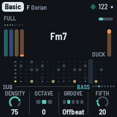

- **Density:** how many of the groove's notes play. At 100, every one; lower, some are left out at
  random, bar by bar (at 50 about half), the bar's first note always kept. **Energy** (PERFORM)
  thins it further, or fills it back towards every note.
- **Octave:** −1, 0 or +1. At 0 the bass sits between E1 and Eb2 (41 to 78 Hz); at +1 an octave
  higher; at −1 an octave lower, E0 to Eb1 (21 to 39 Hz): felt more than heard, and lost on small
  speakers.
- **Groove:** the pattern, from sparse to busy: Drone (one note a bar, held almost to the next),
  Offbeat (the four off-beat eighths), Dotted (two notes a dotted eighth apart, twice a bar), Sync
  (three notes, syncopated) and Roller (six notes a bar, rolling). Density thins any of them.
- **Fifth:** how often a note is the chord's fifth instead of its root. A note on the bar's first
  sixteenth is the root, except with Drone: there Fifth sets how often a whole bar is the fifth.

### SEQ: Drums

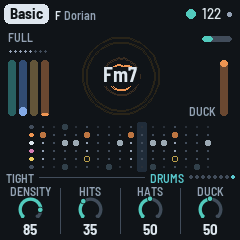

- **Density:** the kick's shape, chosen a phrase at a time: none, the downbeat alone, one and three,
  four with two and four ghosted (10 dB down), or four on the floor. Density is where the shapes
  centre: about 0 none, 25 the downbeat, 50 one and three, 75 the ghosted four; each phrase draws
  one near it, the nearest likeliest. At 100, four on the floor, always. Evolve lets it wander
  further, a Thin phrase takes it a step sparser, and Energy (PERFORM) moves it. The kick is out in
  a Break and the second half of a fill; with the Pattern page on Pattern, your kick lane plays
  instead.
- **Hits:** how busy the hats are. The shaker plays from none to all twelve sixteenths that aren't
  the open hat's, the ones before the beats first. The open hat comes in at 15, on the off-beat of
  beats 1 and 3, and plays all four off-beats from 40. At 0, the kick only.
- **Hats:** the shaker and the open hat against the kick: at 50, as the pieces have them; about
  12 dB down at 0 and 12 dB up at 100. The drums' level (OCT− / OCT+, the Mix page) moves the kick,
  the hats and the rim together.
- **Duck:** how far each beat pushes the rest down, to −12 dB at 100, letting it back in over a
  little more than a tenth of a second. A kick ducks it fully; a beat without one a little less,
  and less again while the arrangement has the kick out (a Break), so the music keeps breathing.
  The noise is ducked deeper than the music.

Swing is on the Key page (HOME, then HOME again). How dark or bright the hats are comes with the
piece (the Drum sound page's Hat tone moves it).

**The Pattern page** (SEQ a third time, after the Drum sound page): the drums' five lanes,
sixteen steps each, to write yourself.

| | |
|---|---|
| KNOB 1 · Lane | Kick, Shaker, Open (hat), Rim, Clap |
| White keys 1–16 | the lane's sixteen steps: a key turns its step on or off (lit when on) |
| A black key held + a white key | that step accented (on, and drawn taller) |
| KNOB 2 · Accent | how much quieter the unaccented steps are, 0 to 100 |
| KNOB 3 · Chance | how likely the lane's steps are to play, 0 to 100%: loose, breathing hats (the clap starts at 5%: rare, as it shines) |
| KNOB 4 · Play | Auto (the patterns generated from Density and Hits) or Pattern (yours) |

The first step you change takes the pattern over from what Auto was playing, and switches Play to
Pattern. The arrangement still takes lanes out over yours (a Break, the second half of a fill,
PERFORM's mutes), and Swing still delays the off sixteenths. Your patterns play as written: the
kick's shapes and the looser hats are Auto's. The patterns are kept with the piece.

### FX: Space

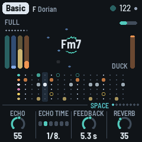

- **Echo:** how much goes to the echo.
- **Echo time:** the tape loop's length: an eighth, a dotted eighth, a quarter, a dotted quarter, a
  half or one bar. The second head, heard while a throw rings, repeats at three quarters of it, or
  with Motion up, wherever it has slid to.
- **Feedback:** how long the repeats go on, shown as the time they take to die away (to −60 dB):
  1.5 s to 15 s. The loop's gain follows the echo time, so a long echo fades as soon as a short
  one. Throws, PERFORM's Dub and the grid's Swell still push it further; past 100% the soft clip
  holds it, and the echo swells and smears on itself. While resting it's kept under 90%, so the
  tails always die out.
- **Reverb:** how much goes to the plate.

### FX again: Echo

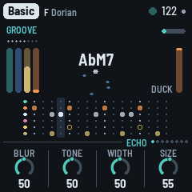

FX on the Space page opens the Echo page (FX blinks while you're here); FX again goes back. The
four are 0 to 100; 50 is the echo as the pieces have it.

- **Blur:** how much each repeat dissolves: at 0, clean copies; at 50, each a little softer and
  more smeared than the last; at 100, a wash.
- **Tone:** what goes into the echo, darker or brighter: a low-pass at about 2 kHz at 50, an octave
  down or up for every 25 (from about 500 Hz to 5 kHz).
- **Width:** how wide the echo sits: at 0, mono; at 50, near the middle; at 100, as wide as it was
  before 1.3.0.
- **Size:** how long the plate rings.

### GLO: Setup

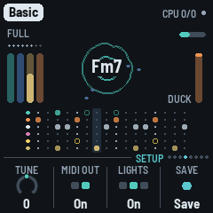

What holds for every piece and the whole machine (the root is the piece's: on the Key page).

- **Tune:** fine tuning, ±50 cents.
- **MIDI out:** on or off.
- **Lights:** On: the keys light the scale, and the unlit buttons glow dimly so they can be read
  on the black FM-1. Keys: the key lights only. Off.
- **Save:** a turn saves all eight pieces. It shows **Save**, its dot lit, while there are unsaved
  changes, and **Saved** after. (GLO held does the same.)

On this page the top right shows the machine instead of the tempo. **CPU 35/61** is how much of
the FM-1's time the sound takes: 35% now (smoothed), and 61% at the heaviest moment of the last
two seconds. Under 100% the sound never breaks up; if it ever did, a **!** and a count of the
dropouts would follow. When a moment runs heavy (past 80%), DUB-1 sheds for half a second what is
least heard, the quietest tails of the pings and the cloud's new grains, so a crowded moment
doesn't break up. Then, next to the battery icon, a rough charge in % (**67%**), or **USB**
when a computer powers (and charges) the FM-1.

---

## 9. MIDI

MIDI comes in over USB and the TRS jack, and goes out over USB.

- **In, channel 1:** a note adds or removes its note from the scale, like a key.
- **In, clock:** the grid follows MIDI clock (six clocks a sixteenth), and start, continue and stop
  start, continue and stop the music. The screen shows EXT for the tempo. When the clock stops
  coming, DUB-1 goes back to its own tempo.
- **Out** (on by default): the chord on channel 1, the pings on 2, the bass on 3 and the drums on
  10 (kick 36, shaker 42, open hat 46), and, while it plays on its own tempo, clock with
  start / stop. Turning MIDI out off sends All Notes Off on channels 1, 2, 3 and 10.

### Screen reader

DUB-1 can tell a screen reader what its screen shows. Connect the FM-1 by USB, open the
[FM-1 Screen Reader](https://charlesvestal.github.io/fm1-reader/) in Chrome or Edge, and click
Connect. It reads out the page you're on and its knobs, a knob's value as you turn it, the piece
and its key, the notes you add or take out, every message, and the chord each time it
moves. Press W to hear the whole screen again: the page, the piece, the chord, the section and its
bar, and the scale. The FM-1 says nothing until the page connects, so a DAW on the same cable
never sees it.

DUB-1's word list (how the reader says what's written on the screen) is published with DUB-1's
site, and the FM-1 tells the reader where to find it.

---

## 10. Saving

DUB-1 keeps all eight pieces in the FM-1's memory, each as you left it: the knobs, the scale, the
mode, the root, the tempo and the pings' octave, plus Tune, MIDI out and Lights.

- **By itself:** a few seconds after a change, but only while resting and once the stabs have
  died away. Writing to the memory interrupts the sound for a moment, so it never happens while
  the music plays. A dot at the top of the screen means there are unsaved changes.
- **GLO held** for half a second, then let go: saves now, playing or not ("SAVED").
- **Setup's KNOB 4 (Save):** shows **Save**, its dot lit, while there are unsaved changes, and
  **Saved** once there aren't; a turn saves.
- **Hold GLO** on for 1.5 s: the piece goes back to its recipe ("RESET"). That isn't saved until the
  next save, so switching off before then brings your version back.

Projects saved by an older DUB-1 are read and converted: each piece keeps what you set, and the
values that are new (the chord's Ghost, the kick's Density, the echo's Blur, Tone and Width, the
noise's Decay) come from its recipe. Hold GLO for 1.5 s on a piece to get its whole new recipe.
Projects saved by AMB-1 aren't read by DUB-1: the first start after installing it begins with the
eight recipes.

---

## 11. Troubleshooting

**Update mode:** hold OCT- and OCT+ together for five seconds. A countdown appears; let go
before it ends to cancel. (A quick press of both, let go within a second, is a layer's mute on its
page; holding them longer never mutes anything.)

**Calibration:** if a button or knob does the wrong thing, hold OCT- and OCT+ while you switch
the FM-1 on. The screen then asks you to press each button and turn each knob in turn.

**After a crash:** DUB-1 shows a red CRASH screen and restarts by itself a few seconds later. The
next start shows RESTARTED AFTER A CRASH and an address (PC ...) for a moment. If you report the
problem, include that address and what you were doing.

**Safe mode:** if DUB-1 crashes twice in a row while starting, it starts in SAFE MODE instead.
There's no sound, but USB works, so the installer can reach it: reinstall with
`tools/fm1_install.py`, or put the stock firmware back with M-UPGRADE. Press PLAY to try starting
DUB-1 normally again. If even safe mode fails twice, the FM-1 drops into the chip's own update
mode, and only the rescue below can reach it.


### Recovering an FM-1 that won't start

An FM-1 in the chip's own update mode shows a blank screen, and neither the installer nor M-VAVE's
updater can see it. A script can put M-VAVE's firmware back, on a Mac, with the USB cable you
already have.

Open Terminal in a checkout of the DUB-1 source and run:

```
bash tools/fm1_rescue.sh
```

1. If a window asks to install the command line developer tools, click Install. When it has
   finished, run the line again.
2. If it asks for a password, type your Mac password (nothing shows as you type) and press Return.
3. When it says it's waiting, plug the FM-1 in and switch it on. The script catches it, checks the
   chip, saves a backup of the FM-1's memory in the `fm1-rescue` folder in your home folder, and
   asks before it writes anything.
4. Type **yes** and press Return. Don't unplug anything until it says it's restarting the FM-1.
   The FM-1 then starts into its original firmware, and you can install DUB-1 again from there.

The script downloads its rescue tool from X0X's repository, M-VAVE's FM-1 V15 firmware and JieLi's
flash loader, and checks the firmware against a known fingerprint. It writes only the firmware
area of the memory, never the bootloader or the FM-1's own settings, and checks everything it
writes. Running it again is always safe. If the FM-1 never shows up at all, Felucca's
[FM-1-transporter](https://github.com/kurogedelic/FM-1-transporter) (a small RP2040 board wired
to the USB lines) can still reach it.

---

## 12. Parameters

The defaults are Basic's; each piece has its own.

| Page | Value | Range | Basic |
|---|---|---|---|
| Dub | Filter | Shut 100 – Off – Open 100 (for playing, not saved) | Off |
| Dub | Evolve | 0–100 | 55 |
| Dub | Motion | 0–100 | 50 |
| Dub | Drift | 2, 4, 8, 16, 32, 64 bars, Hold | 32 bars |
| Chord | Density | 0–100 (1 to 6 stabs a bar) | 15 |
| Chord | Throws | 0–100 (none – about 1 stab in 8 at 50 – about 1 in 3) | 70 |
| Chord | Ghost | 0–100 (the dry 0 dB – −6 dB at 50 – −20 dB) | 65 |
| Chord | Cutoff | 0–100 (110 Hz – 5.4 kHz) | 45 |
| Pings | Density | 0–100 (0 to 5 notes a loop) | 30 |
| Pings | Ghost | 0–100 (the dry 0 dB – −6 dB at 50 – −20 dB) | 70 |
| Pings | Cloud | 0–100 | 30 |
| Pings | Octave | −2 – +2 | 0 |
| Noise | Density, Air, Tone | −50 – +50 | 0 |
| Noise | Decay | 0–100 (about 70 ms – over a second) | 50 |
| Noise | Character (ALGORITHM) | Vinyl, Tape, Dust, Room, Machine | Vinyl |
| Bass | Density | 0–100 (100: every note of the groove) | 75 |
| Bass | Octave | −1 – +1 | 0 |
| Bass | Groove | Drone, Offbeat, Dotted, Sync, Roller | Offbeat |
| Bass | Fifth | 0–100 | 20 |
| Key | Tempo | 90–140 | 122 |
| Key | Root | C – B | F |
| Key | Mode | 8 modes, or Custom | Dorian |
| Key | Swing | 50%–70% | 52% |
| Drums | Density (the kick's shapes) | 0–100 (100: four on the floor, always) | 85 |
| Drums | Hits | 0–100 | 35 |
| Drums | Hats | 0–100 (−12 dB – ×1 at 50 – +12 dB) | 50 |
| Drums | Duck | 0–100 (to −12 dB) | 50 |
| Space | Echo | 0–100 | 55 |
| Space | Echo time | 1/8, 1/8., 1/4, 1/4., 1/2, 1 bar | 1/8. |
| Space | Feedback | 1.5 s – 15 s (the tail, to −60 dB) | 5.3 s |
| Space | Reverb | 0–100 | 35 |
| Echo | Blur, Tone, Width | 0–100 | 50 |
| Echo | Size | 0–100 | 55 |
| Setup | Tune | −50 – +50 cents | 0 |
| Setup | MIDI out | Off, On | On |
| Setup | Lights | Off, On, Keys | On |
| Perform | Filter, Dub, Energy, Space | −100 – 0 – +100 (Filter: Shut, Off, Open); for playing, not saved | 0 |
| ALGORITHM | Screen (all pages but a layer's, the Noise and the Chords page) | Ripples, Scope, Spectrum | Ripples |
| ALGORITHM | The walk (Chords page) | Home, Wander, Free | Wander |
| ALGORITHM | Chord voice (Chord page) | 7 voices | Saws |
| ALGORITHM | Ping voice (Pings page) | 5 voices | Blip |
| ALGORITHM | Bass voice (Bass page) | 5 voices | Sub |
| ALGORITHM | Kit (Drums page) | 5 kits | Tight |
| Chord sound | Attack, Colour, Reso | −50 – +50 | 0 |
| Chord sound | Decay | 0–100 (60 ms – 1.5 s, times the voice's) | 35 |
| Ping sound | Tone, Ratio, Length, Bend | −50 – +50 | 0 |
| Bass sound | Bite, Shape, Length, Slide | −50 – +50 | 0 |
| Chord, Ping, Bass FM | Algo | Voice, 1–8, 2-op | Voice |
| Chord, Ping, Bass FM | Ratio, Feedback, Mod dec | −50 – +50 | 0 |
| Drum sound | Kick tune | −12 – +12 semitones | 0 |
| Drum sound | Kick len, Punch, Hat tone | −50 – +50 | 0 |
| OCT− / OCT+ (a layer's page), Mix (PERFORM, white 6) | Levels: chord, pings, bass, drums (and the noise: OCT on its page) | 0–100, 5 a press | 59, 30, 60, 65 (noise 15) |

Set by the piece only (no knob): the pings' tone (from a round blip to a metallic clank), the
hats' colour, how far each stab opens the filter, and how restless the noise is. Each piece also
has its own voices.

| Piece | Chord | Pings | Bass | Kit | Ping tone | Hats |
|---|---|---|---|---|---|---|
| Basic | Saws | Blip | Sub | Tight | 40 | 50 |
| Chamber | Organ | Glass | Sub | Deep | 30 | 40 |
| Steppers | Saws | Marimba | Punch | Punch | 50 | 60 |
| Fog | Keys | Blip | Sub | Soft | 25 | 30 |
| Concrete | Noise | Wood | Pluck | Punch | 60 | 75 |
| Night Drive | Keys | Drop | Growl | Tight | 45 | 55 |
| Pressure | Tonewheel | Wood | Growl | Deep | 35 | 65 |
| Haze | Pad | Glass | Sub | Dusty | 25 | 35 |

---

## 13. Credits

DUB-1 is free software under the GNU General Public License, version 3. If you share the
firmware, you must also share its source code.

- DUB-1 is a fork of [AMB-1](https://github.com/charlesvestal/fm1-amb) by Charles Vestal
  (GPL-3.0-only), whose loops, echo chain, pieces, UI and platform it keeps.
- The idea comes from AMB-1 and from dub techno in general: chords dissolving in a tape echo over
  a steady kick.
- The reverb is Jon Dattorro's plate ("Effect Design, Part 1", JAES 1997), by way of
  [FoMni-1](https://github.com/charlesvestal/fm1-fomni).
- The granular cloud follows the design of CLOUD in [JIANT](https://github.com/juanjiant-bit/JIANT)
  (GPL-3.0), another FM-1 firmware.
- The Euclidean rhythms are Godfried Toussaint's reading of Bjorklund's algorithm.
- The noise machine (a crackle groove ringing resonators tuned to the chord) follows Bahadirhan
  Kocer's "Using Resonators in Live".
- The random chords are a weighted random walk over the scale's degrees, adapted from AMB-1's
  (see [The layers](#5-the-layers)). They are voiced as dub techno's chord-memory stabs
  (Basic Channel, Maurizio): one shape, moved whole to each new root.
- The platform (hardware layer, USB, update loader, installer and storage) is from
  **Felucca** by Leo Kuroshita, Hügelton Instruments, by way of
  [X0X](https://github.com/charlesvestal/fm1-x0x), FoMni-1 and AMB-1.
- The idea of running FM-1 firmware in the browser comes from [Groove OS](https://www.groove-os.com/).
- The fonts are Barlow Semi Condensed and Terminus (SIL Open Font License).

M-VAVE and FM-1 are trademarks of their owners. DUB-1 is not connected with M-VAVE or Hügelton
Instruments.
