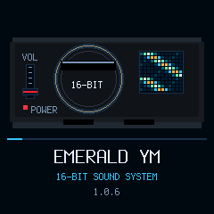
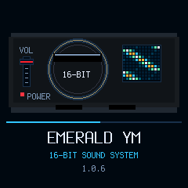

# Vertical boot spectrogram — candidate 1.0.6

Separate branch based on unmerged PR #16. Replace the right-hand vent sweep on the boot console with a colored time/frequency map. Frequency bins run horizontally; time history scrolls vertically upward by one row on each changed animation frame. Dark blue through cyan/green to amber/white indicates simulated intensity. The left animated red fader and progress strip are retained.

The spectrogram is decorative startup imagery, not live audio analysis. Its 12 bins and 11 history rows are generated directly from frame/row indices inside the existing 50x48 tile at (156,57). There is no FFT, history allocation, new framebuffer or blocking delay. Existing cadence/dismissal, song, DSP, MIDI and USB behavior remain unchanged.

Native build, existing UI/LED tests and package/loader simulations pass. Renderer tests compare consecutive history rows to establish upward scrolling, preserve fader endpoint/cleanup assertions and check canvas bounds, unchanged-frame suppression and absence of full clears. Preview visually reviewed. [Build](build.txt.gz) · [UI/LED](ui.txt.gz) · [Package](package.txt.gz) · [Summary/hash](summary.json).

No full audio-suite rerun for this UI-only change; parent 1.0.4 audio/song evidence remains version-specific. No MIDI/device access, flash, release/tag or merge. Exact stable 0.11.3 remains installed/published; target startup timing remains unverified. New PR targets main with PR #15/#16 ancestry and should be reviewed/merged after those dependencies.
