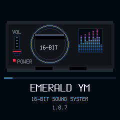
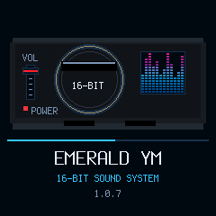

# Reference-style boot spectrum — candidate 1.0.7

The owner clarified the visual with an example of segmented vertical spectrum bars. Replace 1.0.6's scrolling heatmap with twelve independently changing columns rising from a shared baseline. Each has separated horizontal segments and a blue/cyan-to-purple/pink gradient. The example image is a visual reference only; no image pixels, watermark or stock asset are embedded.

Keep the existing 50x48 right-hand tile, 90 ms frame cadence, left red volume fader, progress strip and dismissible boot period. This is decorative startup animation, not audio analysis: no FFT, audio reads, history buffer, blocking delay or new framebuffer. Song/DSP/MIDI/USB are unchanged.

Native build, existing UI/LED tests and package/loader simulations pass. Renderer checks each column's baseline/top, empty space above it, segment/column gaps, retained fader endpoints/cleanup, unchanged-frame suppression, canvas bounds and no whole-screen clears. Native preview visually reviewed. [Build](build.txt.gz) · [UI/LED](ui.txt.gz) · [Package](package.txt.gz) · [Summary/hash](summary.json).

No full audio-suite rerun for this UI-only follow-up. No device/MIDI access, flash, release/tag or merge. Stable exact 0.11.3 remains installed/published; target startup timing is unverified. Separate branch/PR based on unmerged PR #17, targeting main with earlier candidate ancestry.
