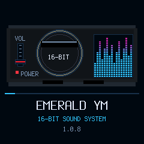
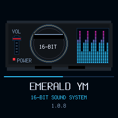

# Larger boot spectrum and matching cyan — candidate 1.0.8

Owner-requested extension of the right boot spectrum toward the console's right side and down to POWER. The complete tile is now 66x72 at (156,57), ending at x=222/y=129 exclusive, with sixteen columns and up to 23 segmented rows. The bottom segments end at y=127, aligned with the POWER text area; the frame ends at y=128. The left animated fader and central deck are unchanged.

Blue segments use exact `Y_BLUE = RGB(50,197,255)`, the same color as **16-BIT SOUND SYSTEM**. Upper segments retain the purple/pink gradient. Decorative boot animation only: no FFT/audio analysis, gain/settings changes, delay, extra framebuffer or song/DSP/MIDI/USB change.

Native build, existing UI/LED tests and package/loader simulations pass. Renderer assertions cover the exact cyan, expanded lower/right edge, shared baseline, variable heights, clear space above bars, segment/column gaps, retained fader behavior, unchanged-frame suppression and canvas limits/no whole-screen clears. [Build](build.txt.gz) · [UI/LED](ui.txt.gz) · [Package](package.txt.gz) · [Summary/hash](summary.json).

No full audio-suite rerun for this UI-only follow-up; previous evidence remains version-specific. No device/MIDI access, flash, release/tag or merge. Stable exact 0.11.3 remains installed/published. Separate branch/PR based on unmerged #18; main target includes earlier candidate ancestry. Physical startup timing is unverified.
