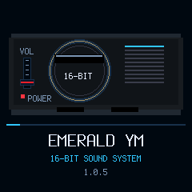
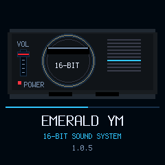

# Boot console volume fader — candidate 1.0.5

Follow-up on a separate branch based on unmerged PR #15 (1.0.4). The characteristic red fader now appears on the left front panel of the original boot console. Across the existing 13 animation frames it rises, reaches the top at frame 6 and returns to the bottom at frame 12. The volume track uses one complete 24x54 tile at LCD x=22, y=58, clear of the cartridge deck and power LED.

This animation is decorative: it does not sample MASTER, change gain or write settings. It shares the existing 90 ms frame cadence and dismissible boot period, with no blocking delay or extra framebuffer. Song, synthesis, MIDI and USB behavior are unchanged from the parent candidate.

Native build, existing UI/LED checks and package/loader simulations pass. Renderer assertions verify the red marker's lower and upper positions and removal of the old marker, unchanged-frame suppression, tile bounds and no repeated whole-screen clears. Raw evidence: [build](build.txt.gz), [UI/LED](ui.txt.gz), [package](package.txt.gz), [summary/hash](summary.json). Parent [1.0.4 full audio/MIDI/song tests](../song-form-1.0.4/README.md) remain version-specific; this UI-only follow-up does not rerun or claim physical tests.

No device/MIDI access, flash, release/tag or merge. Exact stable 0.11.3 stays installed/published. Target boot DMA/UI timing remains unverified. Review/merge after PR #15; the new PR targets main and includes its ancestry.
