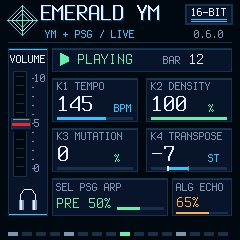

# Console-style MASTER UI 0.6.0 — desktop and physical evidence

This is a new UI development build, identity `FM-1_68000600`. The initial desktop stage below did not install firmware or open physical ports. A subsequent owner-authorized installation and physical test of exact 0.6.0 is recorded separately below; the device now runs 0.6.0. The public 0.4.3 release and all previous package/tag evidence are unchanged.

[Package/hash/memory report](package-verification.json), [raw build log](build.log), [raw desktop tests](desktop-tests.log). Build and the complete `test-ym-windows.ps1` suite passed, including no-soft-double, flash-off/no-XIP-call checks, UAC drift/descriptors, DSP determinism/PSG/FX/settings, actual UI/LED and OTA/loader/mock installer tests. The optional inherited JavaScript installer comparison was skipped, not passed.

| Region | Used | Limit |
|---|---:|---:|
| Application image | 107792 B | build-checked |
| Data + BSS | 39120 B | 98304 B |
| Pool | 101888 B | 344064 B |
| Audio hot code/tables | 21604 B | inside RAMTEXT |
| Total RAMTEXT | 24492 B | 24576 B |

Relative to 0.5.1, application grows 732 B; all RAM/pool/RAMTEXT totals are unchanged. The narrow RAMTEXT margin remains 84 B. No linker regions, startup copy or protective 85% threshold were changed.

The actual renderer tests verify a complete 0..1023 MASTER ADC sweep, top/bottom red-handle positions, monotonic motion, visual hysteresis in both directions, no redraw for small ADC jitter, no writes outside the 22x108 moving tile, no idle writes and no repeated full-screen clear. Knob/transport/instrument/FX/SAVE/overload and LED behavior retain their existing tests. All LCD blit tiles are checked against the 144-row canvas height and 240x240 screen bounds.

The UI mirrors the same filtered physical pot value used by the existing master gain calculation. It does not alter that calculation, add ADC reads, persist MASTER, add a touchscreen interaction or change USB/MIDI/status. The 0-10 scale is control position, not dB or signal amplitude. The initial desktop stage did not establish physical behavior. The subsequent run below adds short-run CPU/recording measurements and owner-confirmed screen/slider behavior; it is not an exhaustive calibration, latency or long-session test. Earlier 0.5.x measurements are not relabelled as 0.6.0 results.

## Native previews

These PNGs are 240x240 captures from the actual C renderer test, not a design mockup or device photograph. Layout is adapted from the owner's supplied reference to fit the real LCD; all graphics are code-drawn, with no new framebuffer or external bitmap asset.

[MASTER minimum](master-min.png) · [MASTER midpoint](master-mid.png) · [MASTER maximum](master-max.png) · [Save error](save-error.png) · [Overload](overload.png).

## Physical test — 2026-10-27

The owner authorized installation of the exact PR #7 package and USB recording with MIDI/status diagnostics. Source commit: `c0530a6cd7d026554e21b957665edfd7fe7d51d9`. Package SHA-256: `ea7a5bff5fcf2671debad1ee32f13b50843d6f51d7fe879f14798097a56fbe89`. Installer verified running identity `FM-1_68000600`. No rebuilt or same-version substitute is used for these results.

- [Raw installation log](hardware/installation.log)
- [Summary](hardware/summary.json), [raw MIDI/status report](hardware/midi-status.json) and [log](hardware/midi-status.log)
- [Capture analysis](hardware/capture-report.json), [Windows endpoint snapshot](hardware/windows-endpoints.json) and [executed scratch recorder](hardware/executed-recorder.py.txt)
- [Original owner response and scope](hardware/owner-feedback.json)

The verified FM-1 recording input remained `Emerald YM FM-1 (Emerald YM FM-1)` in Windows, truncated to 31 characters by WinMM. Only that input and the unique verified Emerald MIDI pair were opened, not microphones or Roland UM-ONE. The scratch recorder is archived as execution evidence, not a portable recording application.

30 seconds of continuous backing, alternating two/three standard live MIDI notes and once-per-second status polling overlapped a 32.34-second stereo PCM16/44100 recording. Result: passed, average sampled audio CPU 46.93%, maximum 72%, max block 4196 us, XRUN 0 / overload 0 / failed boots 0. No effect CCs or persistent settings edits were sent. Physical MASTER movement was requested during this interactive check; its precise timing is not available through status v1.

The owner was asked about MASTER movement in both directions, readability and flicker, and replied: **“Tak, suwak i ekran działają prawidłowo”** (the slider and screen work correctly). This is owner observation, not remote LCD readback or an automated calibration test.

After excluding the first 4 and last 3 seconds, the captured body had peak 13056, RMS 517.64 and zero clipped samples. The longest repeated-frame and zero runs were each 0.363 ms. MASTER affects the recorded amplitude. These checks do not prove absence of every packet glitch, and status v1 does not expose internal UAC packet counters. WAV SHA-256: `06f5195f103e7aec97ad25bc5a4e24b928e62f0105d016dd86153a4e519fe0d6`; the file remains local at `build/master-ui-hardware-0.6.0/usb-mix-live-midi.wav` and is not committed.

The desktop package report intentionally retains `flashed:false`; it describes its original offline stage. This separate hardware section supplies installation evidence. Documentation/source version 0.6.1 adds these reports without a new firmware image or test. Public release 0.4.3 and its own V15/Dinghy transition evidence remain unchanged. No 0.6.0 V15/Dinghy, interrupted-write or multi-hour result is inferred. Playback stopped by cleanup; installed firmware remains 0.6.0.
