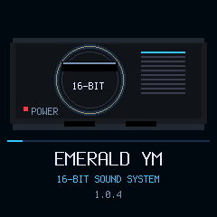
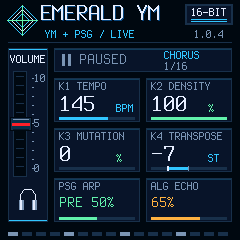

# Song form and animated boot — candidate 1.0.4

The owner requested numbering for future stable releases to start at **1.0.4**. This is a compile/desktop-tested candidate on a separate branch/PR, **not installed or published**. Exact stable 0.11.3 and its release/tag remain unchanged. No MIDI ports, device access, flashing, release/tag or merge in this task.

## Controls and arrangement

- **HOME bright:** song mode, enabled after boot. **HOME dim:** original endless mode. Enabling song mode restarts the current seed. The mode is session-only.
- **PLAY:** start/pause as before; after END, start the current seed again. OUT still restarts with MIDI Start/Clock. REC chooses a new seed and resets the form; USB Start resets it, Continue preserves its position.
- The transport shows the current section and local bar/section length. Mixer controls retain user values; section gating and attenuation are temporary and never stored over them. K2 remains the user's density, scaled by the current section.

| Section | Bars | Behavior |
|---|---:|---|
| INTRO | 8 | Build from bass into percussion, chords and arp; melodic pickup/fill at the end |
| VERSE | 16 | Reduced melodic density, without open hats except the closing fill |
| CHORUS | 16 | Full backing and melodic density |
| BREAK | 8 | Lighter chord/arp/noise arrangement, then fill |
| VERSE | 16 | Return to the verse profile |
| CHORUS | 16 | Full return |
| OUTRO | 8 | Reduce density and audio backing level in bar-sized stages, then END/pause |

Total: **88 bars**, about 160 seconds at 132 BPM. Notes/motifs still depend on seed and mutation; form lengths are fixed in this first implementation. Live keys stay available during the outro and after END. Outgoing MIDI follows section stem gating, including short drums, and sends Stop at completion in OUT. The audio outro fade does not generate external MIDI CC volume automation. Original endless audio remains bit-exact when HOME disables song mode.

Profiles update at the existing main-loop control cadence (~20 ms); a transition/end can follow a native bar boundary by a control interval plus an audio block. This is not sample-exact arrangement automation. Section masks do not change saved levels/effects, and no persistence schema changes are introduced.

## Boot animation

An original console silhouette uses a cyan sweep over the vent rows and a filling progress strip during the existing 1.1-second boot window. It uses changed-only 50x48 and 224x5 tiles, no framebuffer, blocking wait, Sega logo or game assets. Buttons, keys or playback dismiss through the existing path. The animation is silent.

## Desktop evidence and limits

Native build and full desktop tests pass. Existing guards cover flash-off calls, soft-double, control/table addresses, startup copying and unchanged memory-region/85% limits. Original endless-mode dry/FX hashes remain `7ce44fbe` / `f9fae4ef`, also matched by the generic emulator.

New tests render the complete 88-bar form with the actual engine and production control/publishers, verify every phase, automatic MIDI Stop/note cleanup, no idle Clock, reset after END, transient settings and masked short drums. Existing UI tests exercise boot frames within the canvas, unchanged-frame suppression, no full clears and HOME's transport-only redraw; LED checks cover bright song/dim endless HOME. Standard audio/UAC/settings/MIDI and OTA/loader/installer regressions pass; optional inherited JS comparison is skipped as before.

Exact package hash, memory and scope: [summary](summary.json). Raw logs: [build](build.txt.gz), [desktop](tests.txt.gz), [generic](generic.txt.gz). Code fit and host timings do not establish FM-1 performance. Physical CPU/XRUN, startup DMA/UI, live HOME changes, full-song sound and USB Clock/audio/status still need authorized hardware validation on these exact bytes. No earlier version's measurements are transferred to 1.0.4. No release package is published.
