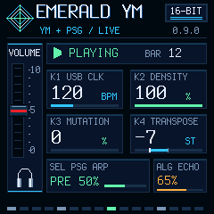
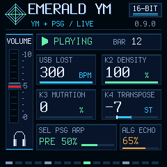

# USB MIDI Clock and TRS MIDI IN — 0.9.0 desktop verification

This candidate was built and tested **on the computer only**. No USB/MIDI port was opened, no device was probed/flashed and no radio was used. Installed/released 0.7.0 remains unchanged. This branch starts from main, independently of Bluetooth prototype PR #9. No new release or tag is published.

## Outcome and memory

| Check | Result |
|---|---|
| Native target compilation and package | Pass, `FM-1_68000900` |
| Application image | 109,520 B |
| Data+BSS | 39,632 / 98,304 B |
| Pool | 101,888 / 344,064 B |
| Audio hot code/tables | 21,672 B |
| Total RAMTEXT | **24,560 / 24,576 B, only 16 B spare** |
| Flash-off code calls / soft-double helpers | None; existing build guards pass |
| Control setters/getters, including new clock setter | XIP address checks pass; existing FL_FAR used |
| Original internal-mode PCM | `7ce44fbe`, unchanged and block-size independent |
| Optimized and generic YM2612 desktop suites | Pass, matching reference PCM/FX hashes |
| USB audio/routing, PSG/FX, persistence, UI/LED | Pass |
| Installer/loader/OTA simulations | Pass; optional inherited JS comparison skipped |
| Physical clock accuracy, TRS wiring/audio, CPU/XRUN | **Not tested** |

The first implementation exceeded RAMTEXT by 24 B. The accepted source computes the existing gate-length division at control rate and reuses the internal tempo accumulator's zero state for external mode, rather than adding another hot-path state load. The final build fits without expanding regions, moving executable buffers, changing startup copying or raising the 85% guard. Runtime CPU headroom cannot be inferred from the 16-byte code margin or desktop CPU timings.

## New coverage

`ym_clock_test.cpp` checks 24 PPQ and six pulses per step, five minutes of simulated arrival timestamps with jitter and repeated TIMER4 wrap, Stop/Continue/Start, timeout/no automatic restart, batched stamps/zero durations and integer BPM estimates from 30 to 300. That five-minute run exercises the clock state, **not a physical link or five minutes of rendered external audio**. The actual renderer separately verifies no free-running step in external mode, waiting before the first Clock, pulse-counted advancement, pause/resume/reset, bounded one-step-per-block catch-up, live keys during pause and return to internal timing.

`ym_midi_test.c` executes the production queue and Emerald dispatcher, plus the real UART byte parser with inert HAL entry points. It checks arrival-time capture despite delayed consumption; independent USB/TRS held masks and per-port CC120/123; running status with interleaved real-time bytes; existing effect CCs; exclusive USB clock/transport ownership; 500 ms loss and explicit restart; FIFO/DMA overflow recovery; queue cursor wrap; overload-latched Start rejection; and ignored TRS SysEx. No HAL register function is executed. USB endpoint scheduling, UART electrical polarity/adapter compatibility and physical concurrency are outside this test.

The real UI tests verify that mode/BPM/loss redraw only the tempo card, stable Clock causes no repeated writes, and 30/300 BPM fit in bounds. Standard renderer/determinism, levels/FX, settings/schema/CRC/power-loss simulations, GLO/USB ONLY and composite MIDI/UAC descriptor tests remain passing. The existing Windows audio-name maintenance helper was not invoked.

## Reproduce and inspect

```powershell
.\build-ym-windows.ps1
.\test-ym-windows.ps1
cmd /c tools\test-ym-generic-windows.cmd
```

These use the [provisioned Windows environment](../../../BUILDING.md). The full suite includes the new tests via `tools/test-midi-windows.cmd`; that command can also run independently. The ignored local candidate is `build/emerald-ym-0.9.0.fwsc`, not an uploaded release binary. Its exact package SHA-256/size and scope are in [summary.json](summary.json), with the [raw package report](package-verification.json).

Raw logs, gzip-compressed without rewriting results: [build](build.txt.gz), [full desktop suite](desktop-tests.txt.gz), [new MIDI/clock tests](midi-tests.txt.gz), [generic emulator](generic-tests.txt.gz), [UI/LED](ui-tests.txt.gz), [installer simulations](installer-tests.txt.gz). Original release evidence remains unchanged; existing dirty 0.1.4 log files were not included in this change.





These are synthetic states drawn by the actual firmware renderer, not device photographs or physical observations. Input scheduling remains quantized to a 256-frame audio block plus USB/main-loop delay; no sample-accurate or measured-jitter claim is made.

## Physical verification still required

At a later authorized stage: use a clock-aware sender to measure transport/phase, tempo changes, long-session stability, unplug/reconnect, overload behavior and simultaneous USB recording/MIDI/TRS. Check the physical minijack with a compatible controller/adapter. The old hardware helper rejects 0.9.0 by identity and must not be casually allowlisted: its Start-only test emits no F8. No additional private SysEx or diagnostic field was added. [User controls and limitations](../../MANUAL.md#usb-midi-clock-and-trs-input--development-090).

Clock count determines step timing; the BPM estimate affects note gates/UI only. Session mode/estimated tempo never enter persistent settings. The status v1 packet is unchanged and does not expose mode/BPM. Song Position Pointer/DAW seeking, MIDI Clock output and TRS transport/Clock remain unsupported. Missing Clock does not cause automatic free-running fallback.
