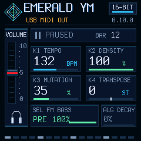

# EDIT / USB MIDI OUT — 0.10.0 verification

Exact 0.10.0 was subsequently installed and physically tested. Read the [physical report](hardware/README.md) separately from the original desktop-stage evidence below. The [v0.10.0 release](https://github.com/CaspiusLabs/Emerald-YM/releases/tag/v0.10.0) preserves that exact package and source commit; documentation 0.10.1 does not rebuild it.

## Original desktop stage

This task only compiled and ran desktop tests. No MIDI port was opened, no device was probed/flashed, and no physical output or target timing was measured. Installed exact 0.9.0 and the public 0.7.0 release are unchanged. This branch builds on unmerged PR #10, independently of Bluetooth PR #9; its PR targets main and must account for that dependency. No release/tag/merge is performed.

## Results

| Check | Result |
|---|---|
| Target package/identity | Pass, FM-1_68001000 |
| Application image | 111,104 B |
| Data + BSS | 40,224 / 98,304 B |
| Pool | 101,888 / 344,064 B |
| Audio hot code/tables | 21,600 B |
| RAMTEXT | **24,488 / 24,576 B; 88 B spare** |
| Flash-off calls, soft-double, MMIO placement, XIP controls/tables | Existing and new guards pass |
| MIDI output | Production queue/publisher and actual engine tests pass |
| Existing input/Clock, audio/UAC, settings, UI/LED | Desktop suites pass |
| Internal-mode dry / FX PCM | Unchanged: 7ce44fbe / f9fae4ef; generic emulator matches |
| OTA/loader/installer | Simulations pass; optional inherited JS comparison skipped |
| Physical USB MIDI OUT, audio concurrency and CPU/XRUN | **Not tested/measured** |
| Minijack MIDI OUT | **Not implemented: no documented supported output interface** |

The minijack remains RX-only. The [manufacturer SDK](https://github.com/m-vave/fm1_open) describes DIN input and USB/BLE output. No guessed GPIO direction, TX mux, baud register or electrical driver is introduced. The manual describes routing FM-1 USB output through a PC/USB host and UM-ONE for physical DIN output.

The snapshot reader and note publisher execute in XIP after ym_render, within render_block's timing window. Added trigger counters preserve retriggers/sub-block drums. Only sequence-selection constants move to the existing XIP pitch section, with explicit address checks; no sample-loop oscillator tables or .audio_hot.fx functions move. Memory-region limits, startup copying, flash-off call prohibition and 85% protective threshold are unchanged. Code fit does not establish real-time headroom.

## Coverage and limits

`tests/ym_midi_out_test.cpp` runs the actual engine, USB queue implementation projected from usb.c, and production publisher with an in-memory receiver. It covers keyboard chords/transposition/releases, stable-note suppression, same-note/serial-wrap retriggers, sub-block drum pulses, correct channels/GM drum notes, full-queue rejection and release retry, suspend/reset CC123 recovery, no stale drums after Stop, queue cursor wrap, approximately 63 s of internal sequencing and a separate short external-clock run with maximum DECAY/reseed. Stop retains held keyboard notes; disabling output clears them. The receiver checks for duplicate active Note Ons. These are simulated links, not Windows endpoint or physical receiver tests. Long backpressure can coalesce events; output is block-quantized, not sample accurate. Update-entry drain is bounded, not a host acknowledgement.

The production input/Clock tests also check EDIT clears USB/TRS held masks, ignores incoming note/FX messages in OUT without dirtying settings, keeps USB Start/Clock service, and drops pre-switch notes on return to IN. Actual UI/LED tests verify bright EDIT, dim IN, header bounds and no repeated redraws in a stable mode. Existing no-allocation/determinism, USB ONLY/UAC, persistence and update simulations pass. Physical disconnect cannot guarantee delivery of Note Off to the old receiver; use host panic if needed.

Reproduce with `./build-ym-windows.ps1`, `./test-ym-windows.ps1`, and `cmd /c tools\test-ym-generic-windows.cmd` using the provisioned Windows environment. Build output stays ignored at `build/emerald-ym-0.10.0.fwsc`; it is not a published release. Exact package hash, memory and scope: [summary.json](summary.json), [package report](package-verification.json).

Unedited, compressed logs: [build](build.txt.gz), [desktop/audio/MIDI tests](desktop-tests.txt.gz), [UI/LED](ui-tests.txt.gz), [generic emulator](generic-tests.txt.gz), [package/loader](package-tests.txt.gz), [mock installer](installer-tests.txt.gz). Historical 0.1.4 dirty logs are excluded.

