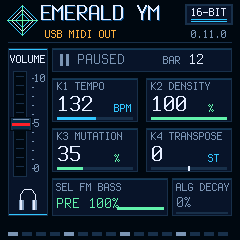

# USB MIDI master Clock / Start / Stop — 0.11.0 desktop verification

This branch starts from merged main (`cc72a7a`, PR #11). The owner authorized a new version, branch and PR with compilation/desktop tests only. **No device was accessed, no MIDI port opened and no firmware installed.** Public/installed exact 0.10.0, its package and tag remain unchanged. No new release/tag or PR merge is performed.

## Result and memory

| Check | Result |
|---|---|
| Native build/package | Pass, FM-1_68001100 |
| Application image | 111,844 B |
| RAM data + BSS | 40,272 / 98,304 B |
| Pool | 101,888 / 344,064 B |
| Audio hot code/tables | 21,604 B |
| Total RAMTEXT | **24,492 / 24,576 B; 84 B spare** |
| Flash-off calls / soft-double / MMIO placement | Existing guards pass |
| XIP snapshot/controls and sequence tables | Address guards pass |
| Audio/generic reference dry / FX hashes | Unchanged: 7ce44fbe / f9fae4ef |
| Input/Clock/output, UAC/routing, settings, UI/LED | Desktop tests pass |
| Installer / OTA / loader | Simulations pass; optional inherited JS comparison skipped |
| Target CPU/XRUN, USB Clock jitter and external equipment | **Not measured/tested** |

The build preserves original regions, startup copying, `.audio_hot.fx` guard coverage, flash-off XIP prohibition and the deliberate 85% protection. Clock count is added to the existing XIP snapshot; the actual native sample loops and synthesis behavior are unchanged. Code fit and desktop CPU timings are not target-performance proof.

## Semantics

EDIT OUT is master: entering it selects internal tempo and, if playing, restarts the arrangement. PLAY in OUT restarts the current seed and sends FA, F8 at 24 PPQ (six per sixteenth), and then same-block notes; pause sends FC. PLAY after a stop starts from the beginning again. There is no outgoing Continue, Song Position Pointer or idle Clock. Tempo changes retain pulse phase. Incoming USB F8/FA/FB/FC are ignored in OUT to prevent feedback; IN retains the follower and fresh input messages. Pre-switch queued performance/real-time input is discarded. EDIT IN stops outgoing transport/releases notes but retains local playback. Clock ownership remains session-only.

The cumulative pulse count derives from actual native sequencer steps/phase, avoiding a separate timer. The audio-owner synchronizer checks whether the previous Clock left the performance queue before the next is due. Missed pulses, a pending Clock or a full queue fail closed: discard uncertain unsent performance packets, retry Stop, request note cleanup and pause backing with USB MIDI WAIT. Only an explicit PLAY restart resumes; no catch-up burst or automatic reconnect start. Keyboard note output can continue while backing is paused. Queue consumption into the USB endpoint is not acknowledgement by external equipment; a disconnected receiver may need its own stop/panic.

## Coverage

`tests/ym_midi_sync_test.cpp` uses the actual engine, production USB performance queue, synchronizer and note publisher with an in-memory receiver. It checks single-byte cable-0/CIN-F realtime packets; Start/Clock before notes; 24 PPQ counts; no idle Clock; one Stop per transition; restart and EDIT disable; pending Clock/full queue failure; full queue at Start; rejected Stop retry; no automatic resume after suspend; no multi-pulse catch-up; unsigned queue/pulse-counter wrap; same-seed reset; tempo changes without a new Start; and the output-disable path used by overload/update. Actual 60-second renders at each of 80, 132 and 180 BPM compare pulse counts against elapsed frames/tempo and verify note/Stop cleanup. Existing output-note tests remain separate.

The actual main-loop MIDI dispatcher/button helpers test master rejection of echoed realtime, unchanged note/FX input gating, reset on PLAY in OUT, and restored IN follower behavior. The native UI test checks the MIDI WAIT header stays within bounds and redraws only on state changes. Full audio/UAC, settings and simulated update tests pass; a later supplemental MIDI run includes the extra Start/Stop full-queue cases. Logs are archived unchanged.

Software clock emission is **block-quantized (~5.8 ms)**, not a submillisecond timestamped stream. These tests do not measure receiver jitter, host routing latency, target load with simultaneous Clock/UAC/status, physical stalls/reconnection, standalone USB-host compatibility or long sessions. Exact 0.10.0 physical numbers must not be transferred to 0.11.0. The minijack stays input; no UART/GPIO output or Bluetooth integration is added.

## Reproduce and inspect

Use the [provisioned Windows toolchain](../../../BUILDING.md): `./build-ym-windows.ps1`, `./test-ym-windows.ps1`, `cmd /c tools\test-ym-generic-windows.cmd`. `tools/test-midi-windows.cmd` includes the new master suite. None of these commands opens MIDI or flashes hardware. The local candidate is ignored at `build/emerald-ym-0.11.0.fwsc`; no release package is published.

Exact candidate hash, memory and scope: [summary.json](summary.json), [package verification](package-verification.json). Raw logs: [build](build.txt.gz), [full desktop/audio tests](desktop-tests.txt.gz), [final MIDI suites](midi-tests.txt.gz), [native UI/LED](ui-tests.txt.gz), [generic emulator](generic-tests.txt.gz), [package/loader](package-tests.txt.gz), [mock installer](installer-tests.txt.gz). Existing dirty 0.1.4 logs are excluded.

