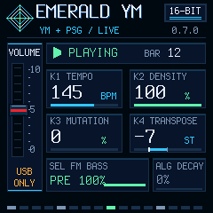

# USB ONLY 0.7.0 — validation

The initial desktop stage passed compilation, linker/memory/no-soft-double/flash-off checks and the full Emerald desktop suite. [Build](build.log), [desktop tests](desktop-tests.log), [package/hash/memory report](package-verification.json). The inherited optional JavaScript comparison was skipped.

Production routing tests verify unity PCM bit preservation, full unchanged USB mix before local ramp/mute, monotonic stereo fade, continued USB signal with entirely silent physical buffer, GLO toggling, ramp continuity with short blocks, exact restored unity, overload silence and buffer boundaries. Real LED tests verify GLO dark/bright/cleared using panel mapping; actual UI tests verify one 40x32 mode-tile update and no repeated idle writes.

Image108032 B (+240 vs0.6.0); data+BSS39120/98304 B, pool101888/344064 B, RAMTEXT24492/24576 B unchanged. The narrow RAMTEXT margin remains84 B; limits/startup copies and the85% guard were not altered. No render allocation or soft double was added.

This desktop report is not a physical speaker/headphone or real-time proof. The owner authorized installation and testing as a subsequent stage; physical results will be recorded independently. Status v1 cannot report GLO state or confirm sound from the physical output. Previous0.6.0 hardware evidence is not relabelled as0.7.0.
