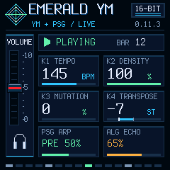

# Emerald YM 0.11.3 — stable

Generative YM2612 + PSG firmware for M-VAVE FM-1, by **Caspius Labs**. This is a stable release, not a GitHub prerelease.

[Download firmware](https://github.com/CaspiusLabs/Emerald-YM/releases/download/v0.11.3/emerald-ym-0.11.3.fwsc) · [SHA256SUMS](https://github.com/CaspiusLabs/Emerald-YM/releases/download/v0.11.3/SHA256SUMS) · [Matching source](https://github.com/CaspiusLabs/Emerald-YM/tree/v0.11.3)

Published from the exact installed and tested package, without rebuilding:

- File: `emerald-ym-0.11.3.fwsc`, 609,677 bytes.
- SHA-256: `a71dae83f0a83f035a60094eee4253be6d32f3d4ac44f50d74bcdda597c95591`.
- Identity: `FM-1_68001103`; USB MIDI/audio name: `Emerald YM FM-1`.
- Tag/source: `v0.11.3` at `b7c6d0f860eb294f2376476e37f6a20f54ab572b`.
- Documentation VERSION 0.11.4 records publication; it is not another device image. PR #14 remains open for owner review.

## Screen and controls

Six-pixel panel gutters and matching 86x44 parameter/mixer cards. Instrument and effect bars sit below their text. GLO is dim with physical audio enabled and bright in USB ONLY, which mutes speaker/headphones while retaining stereo USB capture. Every available assigned button function has visible illumination. MASTER remains the master-mix level; the red slider follows its physical position.

EDIT dim selects USB/TRS note/effect input and USB clock following. EDIT bright selects USB keyboard/sequencer note output and internal master tempo. PLAY in OUT resets the current-seed arrangement, sends Start and 24 PPQ Clock before notes; the next PLAY sends Stop. Incoming realtime is ignored in OUT to prevent feedback. Clock is block-quantized (~5.8 ms); no idle Clock, outgoing Continue or MIDI Thru. The minijack remains input, with no Bluetooth audio/MIDI integration. The shared diagnostic/OTA mailbox dispatch race is fixed.

## Exact-package physical results

211.91 seconds of music with USB MIDI Clock, stereo USB recording in USB ONLY and diagnostics passed. Status: 547 queries / 547 replies, no timeout; maximum reply latency 6.01 ms. Sampled audio CPU averaged 45.73%, maximum 72%, longest block 4189 us. XRUN/overload/failed boots: 0/0/0. Captured 11,364 Clock pulses at average 134.063 BPM; physical Start/Stop worked with no idle Clock or remaining captured notes. Windows arrival timing is not electrical jitter or proof of an external receiver's synchronization.

273.67 seconds of stereo PCM16/44.1 kHz recorded; a 180-second music window had signal and no clipped samples. The owner confirmed the panel layout, below-text instrument bar, dim/bright GLO, physical mute and final stop. These short tests do not establish long-session reliability, USB packet counters, new TRS-input validation or new update/recovery paths. The failed 0.11.0 diagnostic recording remains a failure.

Native build and full desktop suite passed separately. RAMTEXT 24,492/24,576 B (84 B spare), data+BSS 40,272/98,304 B, pool 101,888/344,064 B. Original memory and 85% protection limits remain unchanged.

[Installation](../../docs/INSTALLING.md) · [Manual](../../docs/MANUAL.md) · [Physical reports and scope](../../docs/verification/panel-grid-0.11.3/hardware/README.md) · [Desktop evidence](../../docs/verification/panel-grid-0.11.3/README.md)

