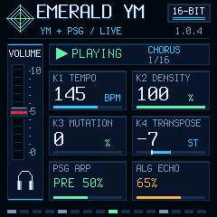
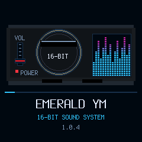

# Emerald YM 1.0.4 — stable

Generative YM2612 + PSG firmware for M-VAVE FM-1, by **Caspius Labs**.

[Download firmware](https://github.com/CaspiusLabs/Emerald-YM/releases/download/v1.0.4/emerald-ym-1.0.4.fwsc) · [SHA256SUMS](https://github.com/CaspiusLabs/Emerald-YM/releases/download/v1.0.4/SHA256SUMS) · [Matching source](https://github.com/CaspiusLabs/Emerald-YM/tree/v1.0.4)

This stable release contains the newly built and physically retested final 1.0.4, published without another rebuild. File 609,677 B; identity FM-1_68010004; SHA-256 `f16da6faa7607541c94ac4bfbb0bb626e95eac0956e990a75317caf5b73a411f`; tag/source `7bb4efdd02499664296e96f134371c68403b22de`. Earlier unpublished 1.0.4 and 1.0.8 candidates are different bytes. Documentation VERSION 1.0.5 records publication only.

## Song mode and HOME

HOME bright selects the default 88-bar song: INTRO 8 → VERSE 16 → CHORUS 16 → BREAK 8 → VERSE 16 → CHORUS 16 → OUTRO 8 → END. HOME dim selects endless generation. Enabling song restarts the current seed. PLAY after END starts again; REC chooses a new seed. Mode/progress are session-only. Section stem/density changes preserve saved mixer/FX/K1–K4; live keys remain independent. In EDIT OUT, PLAY sends Start/24 PPQ Clock and completion sends Stop/note cleanup. Incoming realtime is ignored in OUT. The audio outro fade does not send MIDI volume CC automation. Minijack remains MIDI IN; no Bluetooth integration.

## Screen and boot

Aligned panels with bars below text, complete PLAY triangle and current section/local bar count. Original console-inspired silent boot animation with a moving red fader and enlarged segmented cyan/pink spectrum; cyan matches 16-BIT SOUND SYSTEM. Decorative graphics, not live audio analysis; changed-only small tiles, no new framebuffer or blocking wait. GLO stays dim with physical audio enabled and bright in USB ONLY, muting speaker/headphones while retaining USB capture.

## Validation

Exact final file passed 162.40 s complete-song USB Clock/audio/status measurement. Diagnostics 407/407, no timeout, maximum response 6.55 ms. Sampled music CPU 47.59% average, 72% max, worst block 4233 us; XRUN/overload/failed boots 0. Automatic END/Stop at bar 89, no remaining captured notes or idle Clock. USB audio 203.81 s PCM16/44.1 kHz; analyzed music has signal and no clipping. Owner confirmed corrected PLAY and smooth playback/END.

Native build/full desktop and final UI suites pass separately; RAMTEXT 24,508/24,576 B (68 B spare), existing 85% protection unchanged. Physical results are finite: no new external receiver, electrical jitter, long-session, packet-counter, TRS/live-key or recovery claim. Clock and arrangement changes are block/control-quantized.

**Recorded limitation:** an earlier short trace of the same final bytes reported an unexplained MIDI Stop after about 2.52 s; the owner denied another button press and a later read showed local END/bar 89. The short run remains failed. The complete repeat above had no additional Stop, but the earlier event's cause is not established. See the raw evidence rather than treating the repeat as proof of universal transport reliability.

[Installation](../../docs/INSTALLING.md) · [Manual](../../docs/MANUAL.md) · [Raw evidence and limits](../../docs/verification/stable-1.0.4/README.md). Publication follow-up remains in PR #19; no automatic merge.
